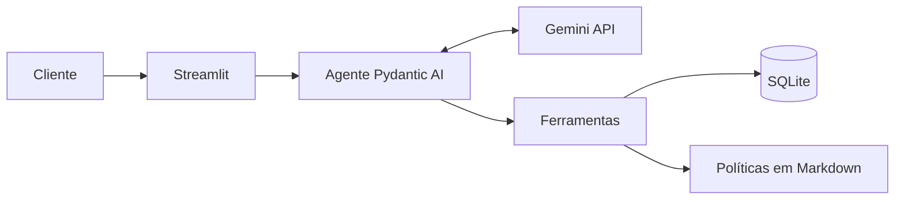

# Empório da Música: agente de atendimento

Agente de atendimento por texto para a Empório da Música, loja de instrumentos musicais em Campo Grande/MS. O sistema responde perguntas recorrentes sobre produtos, pedidos e políticas, e encaminha para a equipe os casos que exigem análise humana.

> **Status:** MVP funcional. O chat atende produtos, pedidos, políticas, devoluções, interesses e encaminhamentos, e a suíte automática roda sem chave de API.

## Funcionalidades

- Persona alinhada ao tom de voz da loja.
- Consulta de produtos, preços, estoque e promoções.
- Consulta de pedidos do cliente identificado.
- Aplicação das políticas de pagamento, entrega, troca e garantia.
- Tratamento de assuntos fora do escopo.
- Histórico persistente e retomada de interesses em novas conversas.
- Avaliação de trocas e devoluções com prazos calculados em código.
- Registro de interesse em produtos indisponíveis.
- Encaminhamento de reclamações e de casos sem resposta segura para a equipe.
- Busca de produtos que tolera um erro de digitação em palavras longas.
- Nova tentativa e mensagens claras quando o provedor recusa por limite de uso ou não responde.
- Painel "Como o Tom chegou a essa resposta" em cada resposta da interface, com rótulos como "Consulta ao catálogo".
- Indicador de que o Tom está digitando e campo de mensagem bloqueado até a resposta.

## Arquitetura

O modelo interpreta a mensagem, escolhe a ação e redige a resposta. O código Python consulta os dados, calcula valores e aplica as regras de privacidade.



## Stack

| Camada | Tecnologia |
|---|---|
| Linguagem | Python |
| Framework de agente | Pydantic AI |
| Modelo | Gemini 3.5 Flash-Lite |
| Dados e persistência | SQLite |
| Interface | Streamlit |
| Testes | pytest |

## Como executar

Requer Python 3.12 ou superior e uma chave do [Google AI Studio](https://aistudio.google.com/apikey).

No Windows, crie o ambiente e instale as dependências:

```bash
python -m venv .venv
.venv\Scripts\activate
pip install -r requirements.txt
```

No Linux ou macOS, use `source .venv/bin/activate` no lugar da segunda linha.

Copie `.env.example` para `.env`, preencha `GOOGLE_API_KEY` e crie o banco local com a carga de dados (sem ela, o app indica este comando):

```bash
python -m src.load_data
```

Inicie o chat:

```bash
streamlit run app.py
```

Execute os testes, que não exigem chave de API:

```bash
python -m pytest
```

## Decisões técnicas

| Tema | Decisão | Justificativa |
|---|---|---|
| Abordagem | Function calling com ferramentas especializadas | O modelo decide a ação, e o código garante dados e cálculos |
| Framework | Pydantic AI | Ferramentas tipadas e pouca estrutura para um único agente |
| Modelo | Gemini 3.5 Flash-Lite, no plano gratuito | Atende ao function calling com baixa latência e sem custo inicial |
| Dados | CSVs validados e carregados em SQLite | Consultas confiáveis, sem servidor |
| Retrieval | Políticas revisadas em Markdown, consultadas por seção | Recuperação previsível para um manual curto |
| Prompt | Instruções fixas e contexto dinâmico | Comportamento estável, com menor consumo de tokens |
| Interface | Streamlit | Chat web simples, mantido em Python |
| Histórico | Mensagens e interesses em SQLite | Continuidade entre conversas |

As decisões completas estão em [Arquitetura](docs/02-arquitetura.md).

## Exemplos de conversa

As conversas de referência estão em [`examples/`](examples/) e foram geradas com o Gemini real:

| Conversa | Mostra |
|---|---|
| [Produto indisponível e interesse](examples/01-produto-indisponivel-e-interesse.md) | Busca com erro de digitação e registro sem promessa de data |
| [Devolução fora do prazo](examples/02-devolucao-fora-do-prazo.md) | Pergunta do canal, prazo em código e oferta de atendente |
| [Parcelamento](examples/03-parcelamento-sem-juros.md) | Duas ferramentas na mesma pergunta |
| [Reclamação encaminhada](examples/04-reclamacao-encaminhada.md) | Acolhimento e registro no mesmo turno |
| [Orçamento, escopo e pedido](examples/05-busca-por-orcamento-e-fora-de-escopo.md) | Linguagem coloquial, recusa de acessórios e status do pedido |

## Limitações conhecidas

- O telefone digitado na interface não é uma autenticação real.
- Os dados não informam o canal da compra nem a data real de entrega.
- Não há previsão de reposição, então o agente informa apenas o estoque atual. O número exato de unidades não é informado: o agente só confirma se a loja atende a quantidade pedida.
- Os limites do plano gratuito do Gemini restringem o volume de uso: cada pergunta consome de 2 a 3 requisições.
- A busca aproximada corrige apenas um erro de digitação por palavra e só vale para nomes com 5 letras ou mais e sem dígitos; códigos de modelo precisam estar corretos.
- O campo de mensagem fica bloqueado enquanto o Tom responde, e recarregar a página nesse intervalo perde a pergunta pendente (ADR-020).
- Os testes com o Gemini real cobrem poucos fluxos, e o comportamento do modelo depende do prompt. As pendências estão em [Testes](docs/05-testes-e-roteiro.md), seção 8.
- O SQLite atende ao MVP, mas não a um uso concorrente de produção.

## Próximos passos

- Integrar com a API oficial do WhatsApp e usar o número autenticado pelo canal.
- Agrupar mensagens enviadas em sequência pelo mesmo telefone antes de chamar o agente, ao integrar um canal como o WhatsApp.
- Notificar clientes quando um produto voltar ao estoque e dar à equipe uma tela para ler os encaminhamentos.
- Integrar com os sistemas de catálogo e pedidos da loja.
- Adotar avaliações contínuas e observabilidade das respostas.
- Migrar para um banco com suporte a uso concorrente.

## Desenvolvimento assistido por IA

O Claude Code apoia a análise dos dados, a comparação de alternativas, a documentação e a implementação. As decisões e a revisão final são feitas pelo responsável do projeto.

- **Desenvolvimento:** cada funcionalidade nasceu de um teste que falha, com a implementação mínima em seguida, e passou por revisão de padrões e de aderência à especificação antes de ir para a `main`.
- **Em execução:** o Gemini interpreta a mensagem e redige a resposta. Preços, estoque, prazos e datas são calculados em código, e uma guarda confere os valores citados contra o retorno das ferramentas (ADR-013).
- **Avaliação:** as conversas de `examples/` vêm de execuções reais, feitas em poucas requisições por causa da cota.

## Dados

Os arquivos em `data/` são fictícios e estão versionados para permitir a reprodução do projeto. O tratamento aplicado está descrito em [Dados](docs/03-dados.md).

## Documentação

| Documento | Conteúdo |
|---|---|
| [Visão e escopo](docs/01-escopo.md) | Objetivos, requisitos, critérios de aceite e riscos |
| [Arquitetura](docs/02-arquitetura.md) | Componentes, fluxos, modelo de dados e ADRs |
| [Dados](docs/03-dados.md) | Fontes, qualidade dos dados e regras de negócio |
| [Especificação do agente](docs/04-agente.md) | Persona, ferramentas e regras de resposta |
| [Plano de testes e cronograma](docs/05-testes-e-roteiro.md) | Casos de teste, cota, etapas e release |
