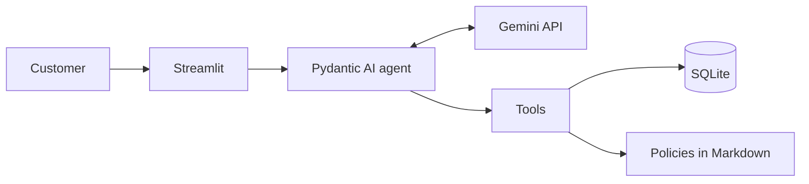

# Empório da Música: customer service agent

Text-based customer service agent for Empório da Música, a musical instrument store in Campo Grande, Brazil. The system answers recurring questions about products, orders, and store policies, and hands off to the store team the cases that need human judgment.

> **Status:** working MVP. The chat handles products, orders, policies, returns, product interests, and handoffs, and the automated test suite runs without an API key.

## Features

- Persona aligned with the store's tone of voice.
- Product, price, stock, and promotion lookup.
- Order lookup for the identified customer.
- Payment, delivery, exchange, and warranty policies applied to each answer.
- Handling of out-of-scope requests.
- Persistent history and resumption of product interests in new conversations.
- Exchange and return assessment, with deadlines calculated in code.
- Interest registration for unavailable products.
- Handoff of complaints, and of cases without a safe answer, to the store team.
- Product search that tolerates one typo in long words, in product names and categories.
- Retries and clear messages when the provider refuses a request due to rate limits or does not respond.
- A "Como o Tom chegou a essa resposta" ("How Tom reached this answer") panel under each answer in the interface, with labels such as "Consulta ao catálogo" ("Catalog lookup").
- Typing indicator, with the message field locked until the answer arrives.

## Architecture

The model interprets the message, chooses the action, and writes the answer. The Python code queries the data, calculates values, and enforces the privacy rules.



## Stack

| Layer | Technology |
|---|---|
| Language | Python |
| Agent framework | Pydantic AI |
| Model | Gemini 3.5 Flash-Lite |
| Data and persistence | SQLite |
| Interface | Streamlit |
| Tests | pytest |

## How to run

Requires Python 3.12 or later and a [Google AI Studio](https://aistudio.google.com/apikey) API key.

On Windows, create the environment and install the dependencies:

```bash
python -m venv .venv
.venv\Scripts\activate
pip install -r requirements.txt
```

On Linux or macOS, use `source .venv/bin/activate` instead of the second line.

Copy `.env.example` to `.env` and fill in `GOOGLE_API_KEY`. The other variables are optional:

| Variable | Default | Purpose |
|---|---|---|
| `GEMINI_MODEL` | `gemini-3.5-flash-lite` | Gemini model used by the agent, always an explicit version (ADR-011) |
| `REFERENCE_DATE` | `2026-03-25` | Date used as "today" for deadlines, because the order data ends in March 2026 |

The Gemini API free tier is enough to run the project: on November 1, 2026 it allowed 15 requests per minute and 500 per day, and each question uses 2 to 3 requests.

Create the local database by loading the data (without it, the app shows this command):

```bash
python -m src.load_data
```

Start the chat:

```bash
streamlit run app.py
```

Run the tests, which do not require an API key:

```bash
python -m pytest
```

To try the interest flow ("chegou o violão?"), simulate a restock in the local database; a new data load restores the original stock:

```bash
python -m scripts.simulate_restock 96 --quantity 5
```

## Technical decisions

| Topic | Decision | Rationale |
|---|---|---|
| Approach | Function calling with seven specialized tools | The model chooses the action, and the code guarantees data and calculations. A SQL agent would widen the risk of improper queries, and RAG over everything is weak at exact filters such as price and stock |
| Framework | Pydantic AI | Typed tools, argument validation, and a test model that runs the agent without API calls, with little structure for a single agent. LangGraph fits flows with several states, which this agent does not need |
| Model | Gemini 3.5 Flash-Lite, on the free tier | Supports function calling with low latency (3.2 s for a price lookup with a tool) and no upfront cost; the version is pinned so behavior does not change without notice |
| Data | CSVs validated and loaded into SQLite | Reliable, parameterized queries without a server; invalid source data stops the load, and the data quality findings are handled explicitly |
| Retrieval | Reviewed policies in Markdown, looked up by section | Predictable retrieval for an 8-page handbook whose tables break under automatic extraction; a vector database would add components without a gain at this volume |
| Prompt | Fixed instructions in Portuguese plus a dynamic context with the date, first name, conversation state, and pending interests | Stable behavior with lower token usage; rules that cannot fail, such as privacy and deadlines, are enforced in code, not only in the prompt |
| Output guardrail | Amounts, percentages, dates, times, phone numbers, quantities, and tracking codes in the answer are checked against the turn's tool results | The model may still invent a value; it gets one correction request, and then the customer receives a safe answer and the case is handed off |
| Interface | Streamlit | Simple web chat, built in Python, with a panel showing which lookups supported each answer |
| History | Messages, conversation state, interests, and handoffs in SQLite, per phone number | Continuity across conversations; the history sent to the model is cut at whole turns to save tokens |

The full decisions are in [Architecture](docs/02-architecture.md).

## Example conversations

The reference conversations are in [`examples/`](examples/) and were generated with the real Gemini model on November 3, 2026, with the current code. They are in Portuguese, as the agent serves Brazilian customers:

| Conversation | Shows |
|---|---|
| [Unavailable product and interest](examples/01-produto-indisponivel-e-interesse.md) | Search with a typo and interest registration without promising a date |
| [Return after the deadline](examples/02-devolucao-fora-do-prazo.md) | Question about the purchase channel, deadline calculated in code, and offer of a human agent |
| [Installments](examples/03-parcelamento-sem-juros.md) | Two tools in the same question |
| [Complaint handed off](examples/04-reclamacao-encaminhada.md) | Empathy and registration in the same turn |
| [Budget, scope, order, and address](examples/05-busca-por-orcamento-e-fora-de-escopo.md) | Colloquial language, refusal of accessories, order status with the delay calculated in code, and the store address |

## Known limitations

- The phone number typed in the interface is not real authentication.
- The data does not include the purchase channel or the actual delivery date.
- There is no restock forecast, so the agent only reports current stock. The exact number of units is not disclosed: the agent only confirms whether the store can meet the requested quantity.
- The Gemini free tier limits restrict usage volume: each question consumes 2 to 3 requests.
- Fuzzy search corrects only one typo per word and only applies to words with 5 or more letters and no digits; model codes must be spelled correctly.
- The message field is locked while Tom answers, and reloading the page during that interval loses the pending question (ADR-020).
- Tests with the real Gemini model cover a limited set of flows, and the model's behavior depends on the prompt. Open items are listed in [Test plan](docs/05-test-plan.md), section 8.
- SQLite is enough for the MVP, but not for concurrent production use.

## Next steps

- Integrate with the official WhatsApp API and use the phone number authenticated by the channel.
- Group messages sent in quick succession by the same phone number before calling the agent, when integrating a channel such as WhatsApp.
- Notify customers when a product is back in stock, and give the team a screen to read the handoffs.
- Integrate with the store's catalog and order systems.
- Adopt continuous evaluation and observability of the answers.
- Migrate to a database that supports concurrent use.

## AI-assisted development

Claude Code wrote the Python code and recommended the agent framework (Pydantic AI). The project owner led the work: asked for the documentation before any code, required tests, analyzed the alternatives, and approved the decisions recorded in the ADRs.

The workflow:

1. **Documentation first.** Claude Code analyzed the CSVs and the policy handbook and drafted the scope, the data quality findings, the agent specification, the test plan, and the architecture decisions in `docs/`. The owner reviewed and approved them before any code was written.
2. **Planning in GitHub Issues.** A spec was split into vertical-slice tickets, each one implemented in its own Claude Code session.
3. **Test-driven development.** The project instructions (`CLAUDE.md`) require a `tdd` skill: each behavior starts from a failing test, followed by the minimal implementation. Every fixed bug leaves a test with the `regression` marker.
4. **Review before `main`.** A code review skill checked each ticket against the coding standards and against the ticket's specification; findings were fixed or recorded as open items in `docs/05-test-plan.md`.
5. **QA with the real model.** Separate Claude Code sessions ran test batteries with the real Gemini model on a temporary database, filed the findings (QA-nn), and retested the fixes. The owner authorized the number of requests before each run, because of the free tier quota.
6. **Language pass.** At the end, Claude Code translated the documentation, the comments, and the identifiers into English, one module per commit with the tests green, and the agent was validated again with the real model (see Assumptions).

- **At runtime:** Gemini interprets the message and writes the answer. Prices, stock, deadlines, and dates are calculated in code, and a guardrail checks the values cited in the answer against the tool results (ADR-013).
- **Evaluation:** the conversations in `examples/` come from real runs, made with few requests because of the quota.

## Data

The files in `data/` are fictitious and versioned so the project can be reproduced. The processing applied to them is described in [Data](docs/03-data.md).

## Documentation

| Document | Content |
|---|---|
| [Vision and scope](docs/01-scope.md) | Goals, requirements, acceptance criteria, and risks |
| [Architecture](docs/02-architecture.md) | Components, flows, data model, and ADRs |
| [Data](docs/03-data.md) | Sources, data quality, and business rules |
| [Agent specification](docs/04-agent.md) | Persona, tools, and answer rules |
| [Test plan and schedule](docs/05-test-plan.md) | Test cases, quota, milestones, and release |

## Assumptions

The case was provided in Portuguese, but the recruiting email required all responses in English. Therefore, all documentation is in English, while the agent itself converses in Brazilian Portuguese, since it serves a Brazilian store's customers. The system prompt and the example conversations stay in Portuguese for the same reason.

- **Text the model reads stays in Portuguese.** Besides the system prompt, this covers the tool descriptions, the retry messages sent by the guardrail, and the fixed texts returned by the tools. The store policies (`data/politicas.md`), the CSV files, and the Portuguese expressions the guardrail looks for in the answers are also unchanged.
- **The database is not migrated.** The schema (tables, columns, and `CHECK` values), the stored values, and the enumeration values the model reads (such as `arrependimento` or `disponivel`) keep their original names.

The store data and handbook leave some points open. The project assumes:

- **"Today" is March 25, 2026.** The orders go up to March 22, 2026, so a fixed, configurable reference date keeps deadlines consistent with the data (`REFERENCE_DATE`).
- **The phone number identifies the customer.** It stands for the identifier a messaging channel such as WhatsApp would provide; typing it in the interface is not authentication (ADR-009).
- **Receipt is the estimated delivery.** Orders have no actual delivery date or purchase channel, so deadlines count from the estimated delivery, the answer says so, and the agent asks for the channel when the right of withdrawal depends on it.
- **The catalog is the source of truth.** `products.csv` prevails over the handbook (which mentions more than 300 items), the product name prevails over a conflicting description, the recorded order total prevails over the sum of the items, and only promotions marked active are applied.
- **Handbook conflicts are resolved conservatively.** Conflicting phone numbers, minimum installments, and deadlines follow the interpretation recorded in [Data](docs/03-data.md), section 4.5, and must be confirmed by store management before production use.

Commit messages were translated into English at the end of the project to meet the English requirement. Commit contents, order, and dates are unchanged.
