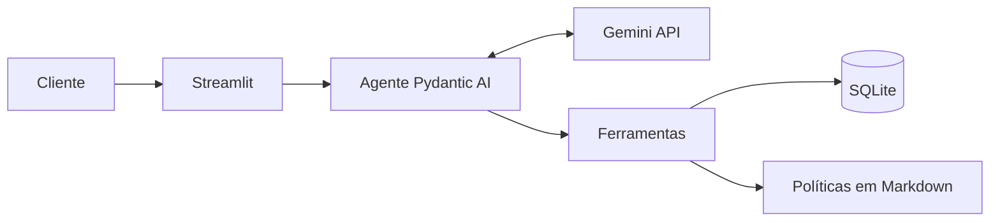

# Empório da Música: agente de atendimento

Agente de atendimento por texto para a Empório da Música, loja de instrumentos musicais em Campo Grande/MS. O sistema responde perguntas recorrentes sobre produtos, pedidos e políticas, e encaminha para a equipe os casos que exigem análise humana.

> **Status:** em desenvolvimento. O chat já responde preços do catálogo, e as demais funcionalidades estão em implementação.

## Funcionalidades

- Persona alinhada ao tom de voz da loja.
- Consulta de produtos, preços, estoque e promoções.
- Consulta de pedidos do cliente identificado.
- Aplicação das políticas de pagamento, entrega, troca e garantia.
- Tratamento de assuntos fora do escopo.
- Histórico persistente e retomada de interesses em novas conversas.
- Encaminhamento de reclamações para a equipe.

## Arquitetura

O modelo interpreta a mensagem, escolhe a ação e redige a resposta. O código Python consulta os dados, calcula valores e aplica as regras de privacidade.



## Stack

| Camada | Tecnologia |
|---|---|
| Linguagem | Python |
| Framework de agente | Pydantic AI |
| Modelo | Gemini 3.5 Flash-Lite |
| Dados e persistência | SQLite |
| Interface | Streamlit |
| Testes | pytest |

## Como executar

Requer Python 3.12 ou superior e uma chave do [Google AI Studio](https://aistudio.google.com/apikey).

No Windows, crie o ambiente e instale as dependências:

```bash
python -m venv .venv
.venv\Scripts\activate
pip install -r requirements.txt
```

No Linux ou macOS, use `source .venv/bin/activate` no lugar da segunda linha.

Copie `.env.example` para `.env`, preencha `GOOGLE_API_KEY` e crie o banco local:

```bash
python -m src.load_data
```

Inicie o chat:

```bash
streamlit run app.py
```

Execute os testes, que não exigem chave de API:

```bash
python -m pytest
```

## Decisões técnicas

| Tema | Decisão | Justificativa |
|---|---|---|
| Abordagem | Function calling com ferramentas especializadas | O modelo decide a ação, e o código garante dados e cálculos |
| Framework | Pydantic AI | Ferramentas tipadas e pouca estrutura para um único agente |
| Modelo | Gemini 3.5 Flash-Lite, no plano gratuito | Atende ao function calling com baixa latência e sem custo inicial |
| Dados | CSVs validados e carregados em SQLite | Consultas confiáveis, sem servidor |
| Retrieval | Políticas revisadas em Markdown, consultadas por seção | Recuperação previsível para um manual curto |
| Prompt | Instruções fixas e contexto dinâmico | Comportamento estável, com menor consumo de tokens |
| Interface | Streamlit | Chat web simples, mantido em Python |
| Histórico | Mensagens e interesses em SQLite | Continuidade entre conversas |

As decisões completas estão em [Arquitetura](docs/02-arquitetura.md).

## Exemplos de conversa

*Em implementação.* As conversas de referência ficarão em `examples/`.

## Limitações conhecidas

- O telefone digitado na interface não é uma autenticação real.
- Os dados não informam o canal da compra nem a data real de entrega.
- Não há previsão de reposição, então o agente informa apenas o estoque atual.
- Os limites do plano gratuito do Gemini restringem o volume de uso.
- O SQLite atende ao MVP, mas não a um uso concorrente de produção.

## Próximos passos

- Integrar com a API oficial do WhatsApp e usar o número autenticado pelo canal.
- Notificar clientes quando um produto voltar ao estoque.
- Integrar com os sistemas de catálogo e pedidos da loja.
- Adotar avaliações contínuas e observabilidade das respostas.
- Migrar para um banco com suporte a uso concorrente.

## Desenvolvimento assistido por IA

O Claude Code apoia a análise dos dados, a comparação de alternativas, a documentação e a implementação. As decisões e a revisão final são feitas pelo responsável do projeto. Esta seção será detalhada na primeira versão funcional.

## Dados

Os arquivos em `data/` são fictícios e estão versionados para permitir a reprodução do projeto. O tratamento aplicado está descrito em [Dados](docs/03-dados.md).

## Documentação

| Documento | Conteúdo |
|---|---|
| [Visão e escopo](docs/01-escopo.md) | Objetivos, requisitos, critérios de aceite e riscos |
| [Arquitetura](docs/02-arquitetura.md) | Componentes, fluxos, modelo de dados e ADRs |
| [Dados](docs/03-dados.md) | Fontes, qualidade dos dados e regras de negócio |
| [Especificação do agente](docs/04-agente.md) | Persona, ferramentas e regras de resposta |
| [Plano de testes e cronograma](docs/05-testes-e-roteiro.md) | Casos de teste, cota, etapas e release |
