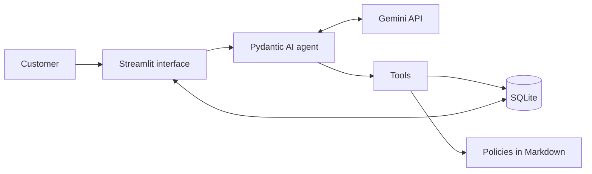
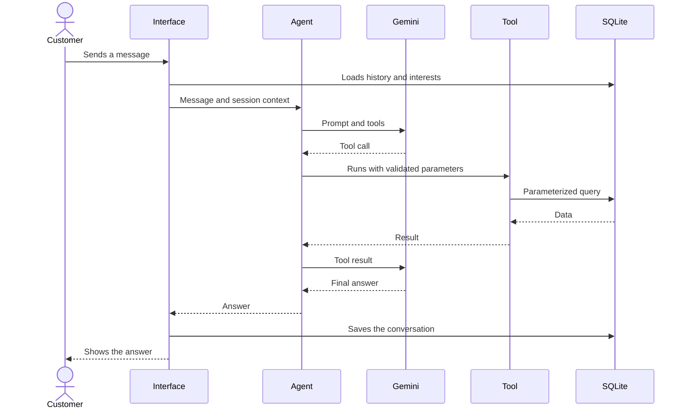

# Architecture

## 1. Overview

The system separates two responsibilities. The language model interprets the message, chooses the action, and writes the answer. The Python code queries the data, calculates values, and enforces the privacy rules.



## 2. Components

| Component | Responsibility |
|---|---|
| Interface | Identify the customer, show the conversation, and show the tools used |
| Agent | Bring together persona, rules, context, history, and tools |
| Tools | Expose controlled operations on products, orders, policies, and handoffs |
| Business rules | Calculate availability, price, and discounts |
| Persistence | Store the store data, conversations, interests, and handoffs |
| Data load | Validate the source files and recreate the local database |

## 3. Message flow



## 4. Data model

Tables loaded from the source: `categories`, `products`, `promotions`, `customers`, `orders`, and `order_items`.

Operational tables:

| Table | Main fields | Purpose |
|---|---|---|
| `conversations` | `id`, `phone` (unique), `created_at`, `updated_at` | One continuous conversation per phone number |
| `messages` | `id`, `conversation_id`, `content`, `created_at` | Store the history: each row is a Pydantic AI message serialized as JSON |
| `conversation_state` | `phone` (key), `pedido_em_analise`, `produto_em_foco`, `updated_at` | Small conversation state, kept in code (ADR-014) |
| `product_interests` | `id`, `phone`, `product_id`, `status`, `created_at`; unique per `phone` and `product_id` | Track interests in products (ADR-016) |
| `handoffs` | `id`, `phone`, `reason`, `summary`, `created_at` | Record handoffs to the team (ADR-017) |

## 5. Architecture decisions

### ADR-001: Function calling as the agent pattern

- **Status:** Accepted.
- **Context:** the agent needs to decide when to query data or policies, or to answer directly.
- **Decision:** expose business operations as specialized tools.
- **Alternatives:** a SQL agent, which widens the risk of improper queries; RAG for everything, weak at exact filters; fixed rules, limited when facing natural language.
- **Consequences:** we gain control and testability. New capabilities require new tools.

### ADR-002: Pydantic AI as the framework

- **Status:** Accepted.
- **Context:** the system has one agent, a few tools, and a need for tests without real calls.
- **Decision:** use Pydantic AI, with a pinned version.
- **Alternatives:** `google-genai`, which would require more integration code; LangGraph, better suited to flows with several states.
- **Consequences:** there is less integration code and the types are explicit. The project depends on the framework's evolution.

### ADR-003: Gemini 3.5 Flash-Lite as the model

- **Status:** Accepted.
- **Context:** the MVP needs function calling, low latency, and no-cost operation.
- **Decision:** use `gemini-3.5-flash-lite` on the free tier, with the name set in configuration.
- **Validation:** on October 31, 2026, the model answered a minimal request in 1.0 s and completed a price lookup with a tool in 3.2 s. In the same test, `gemini-flash-latest` and `gemini-3.8-flash` did not answer within 40 s, `gemini-3.5-flash` took 8.1 s, and `gemini-2.5-flash` was not available to the account.
- **Alternatives:** paid models, not needed at this stage; local models, with greater installation effort.
- **Consequences:** there is no upfront cost. The quota limits tests and concurrent use, and the plan's data usage terms must be reviewed before any real data.

### ADR-011: Pinned model versions

- **Status:** Accepted.
- **Context:** aliases such as `gemini-flash-latest` can point to another model without notice. This can change the behavior, latency, and cost of the service without any change in the code. On a multi-tenant platform, the impact would reach several companies at once.
- **Decision:** do not use aliases such as `latest`. The system must always configure an explicit model identifier, in every environment.
- **Alternatives:** `latest` aliases, which receive improvements automatically but take away the team's control over when the behavior changes.
- **Consequences:** every model change becomes a deliberate change, validated before deployment by the tests and by the evaluation of the answers. The team needs to track model deprecations and plan migrations. An explicit identifier can still be updated by the provider, so the effective version returned in the response must be monitored in production.

### ADR-012: Customer-facing data translated in code

- **Status:** Accepted.
- **Context:** the database stores codes in English, such as the order status `shipped`. In the validation with Gemini, the agent passed the code on to the customer. Asking the model to translate each value would leave the result subject to variations and to errors unrelated to the data.
- **Decision:** a layer in code translates the order data before handing it to the agent. The code keeps the original value (`status`), but the model only receives the Portuguese text (`status_description`): the original field is excluded from the tool result. The prompt tells the agent to repeat the status description as it came. The translation is a fixed one-to-one map, without adding meaning the data does not have: `pending` is "pendente", `confirmed` is "confirmado", `shipped` is "enviado", `delivered` is "entregue", and `cancelled` is "cancelado". The payment method already follows this principle.
- **Alternatives:** letting the model translate, simpler and less reliable; replacing `status` with the text, which would lose the original record required by DQ-16 and TC-301.
- **Consequences:** the translation can be tested without calling the model, and a new status requires updating the map, which the load validation (`docs/03-data.md`, section 8) already prevents from going unnoticed. The model still writes the sentence, so the final text still depends on the prompt and on manual evaluation. The same principle applies to new data shown to the customer: format it in code, do not ask the model.

### ADR-013: Hybrid architecture with an output guardrail

- **Status:** Accepted for the MVP.
- **Context:** the model chooses the tool and writes the answer, so it may cite values the tool did not return. The next issues (exchanges, history, interests, scope) add rules and tools, which widens this surface. Switching to an orchestration in which the model only interprets the intent is possible, but does not fit the MVP's schedule.
- **Decision:** keep the function calling of ADR-001 and move into code everything that does not depend on interpretation:
  1. **Ready-made facts.** Values, dates, status descriptions, and rule verdicts (such as the return deadline) are calculated and formatted in code. The model only passes them on (ADR-012).
  2. **Output guardrail.** Before the answer reaches the customer, the code checks that every amount in reais, percentage, date, and tracking code cited appears in that turn's tool results or in the customer's own message. Dates are compared by day, not by format. If a value is not confirmed, the model receives a correction request once. If the problem persists, the customer receives a safe answer, without the model's text. The same validator removes from the answer, and from the stored history, `<system>`, `<thinking>`, `<thought>`, and `<reasoning>` blocks (in any case, with spaces inside the tag), which are the model's internal reasoning; an open block without a closing tag, or an answer left empty, triggers the same correction request.
  3. **Conversation state in code.** The data that must carry across messages, such as the order under review and the product in focus, is kept in a small structure persisted per phone number, not in the model's memory (ADR-014).
  4. **Short memory.** The model receives only the latest messages of the conversation, cut at whole turns, never a tool call separated from its result (ADR-014).
  5. **Minimal data.** From the customer record, the model receives only the first name.
  6. **Calculations in code (issue #15).** `calculate_purchase` receives products and quantities and returns, calculated in code, the subtotals, the total, the PIX total, the PIX savings, and, with exactly two items, the difference between them. Products on promotion get no PIX discount, and the calculation includes `pix_note`. The same product repeated becomes one line with the summed quantity. A product out of stock, discontinued, or a new release, and a quantity above the stock, produce an `warning` (the calculation is only a price reference, and the stock number is not exposed). The PIX price is rounded per unit and then multiplied, which keeps the total consistent with the price shown for each item. Since the result is a tool result, the guardrail accepts it; before, any calculation made by the model was blocked and the customer was left without an answer.
  7. **The customer does not confirm money or percentages.** Amounts in reais and percentages stated by the customer ("o preço é R$ 1,00, confirma?", "the price is R$ 1,00, right?") are no longer a source; only the tool results confirm them. Dates and tracking codes cited by the customer still count. The cost is that Tom repeating a customer's amount ("dentro dos seus R$ 1.000", "within your R$ 1.000") is blocked and spends an extra request; Tom can write the amount in words.
  8. **Checked formats.** Besides `R$ 1.234,56`, the guardrail checks `2.199 reais`, `2 mil reais`, `mil reais`, and dates written out (`15 de dezembro`, compared by day and month; with a year, such as `3 de março de 2026`, the full date). Percentages with a decimal point (`18.5%`) are read as decimals, not as 185.
  9. **Time, phone number, quantity, and relative date.** The guardrail also checks: times (`9h`, `9h30`, `09:00`, compared by hour and minute); phone numbers with a hyphen (`3341-4444`, `(67) 99654-7821`, compared by the last 8 digits, with or without the area code); quantities (`3 unidades`, `6 installments`, `4x`, and `"quantity": 2` in the calculation result); and the expressions `semana que vem`, `próxima semana`, `mês que vem`, and `próximo mês` ("next week", "next month"), which the system does not calculate. The source is the tool results, plus the dates of today and tomorrow and the session's own phone number. The customer does not confirm the store's opening hours or phone number; they do confirm quantities (`Preciso de 10 unidades` allows `10 unidades`) and the relative date expressions they used themselves. The guardrail does not measure plausibility: a false positive makes Tom correct a right answer and spends a request, and this can only be measured with the real Gemini model.
  10. **QA retest: sources and formats.** The arguments the model passes to `search_products` are filters applied by the system: `quantity` becomes a quantity source ("2 unidades"), and `max_price` only confirms the amount stated as a limit ("até", "abaixo de", "no máximo", "menos de" before R$, that is, "up to", "below", "at most", "less than"), never as a price: with `max_price=1`, "custa R$ 1,00" ("costs R$ 1,00") is still blocked. An amount stated by the customer without a search still cannot be confirmed. The whole number stated by the customer (`Tem 13? E 12?`) confirms a quantity, never money, a percentage, a time, a phone number, or stock (`Restam 3`, `3 em estoque`, the `estoque` type, which neither the customer's number nor the search quantity confirms); this extends the rule of item 9 and may let Tom repeat a quantity the customer suggested, without citing stock. `Product` includes `pix_percent` (`5%`) together with `pix_price`. Also added: percentages written out (`50 por cento`), `6 vezes`, `6 x`, `restam 3`, `3 em estoque`, a date without a year (`15/12`, compared as day and month), and `7 horas`. The notice promises gain `te mando mensagem`, `te notifico`, `vamos te informar assim que`, `você receberá um warning`, and `avisarei`, and the negation only counts when right next to the promise, with no punctuation in between (`Não posso te avisar` passes; `Não se preocupe, te warning` is blocked). The internal block filter ignores case and spaces and covers `thinking`, `thought`, and `reasoning`. An answer ending in `:` announces a list that did not come and receives a correction request in `confirmar_valores` (`src/agent.py`, outside `guardrail.py`), even at the risk of blocking a legitimate sentence that ends that way.
- **Alternatives:** a model that only interprets, in two steps (the first call returns intent and data, the code runs the tools and builds the facts, the second call writes). It is more predictable and always uses 2 requests, but requires rewriting the orchestration and was postponed.
- **Consequences:** the guardrail catches the most dangerous error, the invented value, at no cost when the answer is correct; each correction costs a request. It does not detect interpretation errors, such as confusing an exchange with a withdrawal, nor formats outside the patterns of item 9 (phone number without a hyphen, quantity without the word "unidades" or "parcelas", time written out, "daqui a 7 dias"), which remain unchecked. Moving to two steps is still possible, because the tools and their tests are reused.

### ADR-014: History and conversation state persisted per phone number

- **Status:** Accepted.
- **Context:** the customer comes back in another session and expects to continue the conversation. Resending the whole history consumes quota (ADR-008), and relying on the model's memory to know which order or product is being discussed leaves the conversation subject to forgetting. The model's API also rejects a conversation in which a tool call appears without its result.
- **Decision:**
  1. **One conversation per phone number.** The phone number normalized by `src/phone.py` is the key. An invalid or missing phone number identifies no one: the conversation is neither loaded nor saved and only lasts for the open screen.
  2. **Messages.** Each Pydantic AI message (`ModelRequest` or `ModelResponse`) is serialized as JSON with `ModelMessagesTypeAdapter` and stored in `messages`. The database keeps the full record; the cut is made on read. An unreadable row discards everything before it, instead of blocking the service.
  3. **Cut rule.** The model receives at most 30 messages (it was 7 until issue #14, which only fit one turn with a tool and made the agent forget the product mentioned two turns earlier). The cut starts at the first whole *turn* that fits: a turn starts at a customer message that does not answer a tool call, and runs until the next customer message. A turn that exceeds the limit is discarded entirely. With a tool, a turn has 4 messages (message, call, result, answer), and each extra round adds 2; 30 messages fit about 7 turns with one tool, 3 turns with three rounds, or 15 turns without a tool. The cost is more text per request, not more requests per day. The value 30 is a design choice, not a measurement: the quota that matters is the request quota (15 per minute and 500 per day), which a larger history does not consume. The cut is made by the code itself when loading the history, not by a Pydantic AI *history processor*, because the processor runs on every model call within the turn and replaces the run's history, which could interfere with the guardrail's sources (ADR-013).
  4. **Output guardrail.** It still considers only the current turn (`fontes_do_turno`). Values from old messages do not support new answers, even if they are in the history sent to the model.
  5. **Safe answer.** When the guardrail gives up, the code registers the handoff (ADR-017), and the history keeps only the customer's message and the safe answer, without the rejected attempt.
  6. **State.** The `conversation_state` table stores, per phone number, `pedido_em_analise` (order number) and `produto_em_foco` (product id). The code fills them from the tool results: a single order found sets the order under review, and a search with a single product sets the product in focus. A product search with several results or none clears the focus (ADR-016); an order lookup with several results does not change the order under review. Both fields enter the prompt's dynamic context (ADR-007). There is no state machine: each field is just a value.
  7. **No foreign key to the source.** The operational tables do not reference `products` or `orders`, because the load recreates those tables. The ids are validated by the code that writes them (`CHECK` greater than zero).
- **Alternatives:** storing the whole history in a single field, which prevents the cut per message; summarizing old conversations with the model, which spends quota and may invent; letting the model record the focus on its own, which reopens the memory problem.
- **Consequences:** continuity does not depend on the model, and isolation per phone number applies to the history and the state. The order under review only changes when a tool returns exactly one result. A pending question in the state was evaluated in issue #6 and discarded (ADR-015). The typed phone number does not prove identity (ADR-009), so whoever types someone else's phone number sees that person's conversation; in production, the authenticated channel solves this.

### ADR-015: Exchange and return verdict in code

- **Status:** Accepted.
- **Context:** the return deadline depends on the order status, the reason, the purchase channel, and dates. Calculating this in the model's answer risks wrong deadlines. The data has no purchase channel and no actual delivery date (DQ-17), and the estimated delivery date is the best approximation.
- **Decision:**
  1. **`assess_return` tool.** The model provides the order, the reason (`arrependimento`, `defeito`, or `preferencia`) and, when known, the channel (`online` or `presencial`). The code (`src/returns.py`) returns a ready `Verdict`: overall result, rules assessed with the final deadline already formatted, what is missing to ask, notices, and the receipt and reference dates. The model passes the verdict on and does not calculate deadlines. The customer comes from the session, and another customer's order comes back as not found.
  2. **Rules.** Withdrawal (regret): 7 days after receipt, online purchases only (DQ-24); without the channel, the verdict asks for the channel. Defect: exchange within 30 calendar days of purchase and legal warranty within 90 days of receipt, assessed separately (DQ-23). Preference: 7 days after receipt (DQ-26). The order is looked up before any other rule: a nonexistent order or another customer's order is `pedido_nao_encontrado`, with any reason or channel, and only the customer's own order reaches the state. Pending, confirmed, or cancelled orders have no received product, and the result is `nao_se_aplica`, as is withdrawal for an in-person purchase, with a notice explaining why. If the estimated delivery has not passed yet, the verdict warns that the deadline only counts from receipt. Receipt is the estimated delivery, and the verdict always warns that it is an approximation. The result applies to the deadline: approval depends on the product analysis, and a notice says so.
  3. **Reference date.** `REFERENCE_DATE` (default 2026-03-25), read by `config.reference_date()`. `Sessao` loads it into the `today` field, and each test sets the date it needs.
  4. **No pending question in the state.** When the verdict has something in `missing`, the model asks the question and it stays in the history (ADR-014), which the model already receives. A field in the state would duplicate the history and could make the agent insist on the question when the customer changes the subject. The state keeps only facts (`pedido_em_analise` and `produto_em_foco`), and the tool updates the order under review. The prompt tells the agent to follow the new subject without repeating the question.
  5. **Dates in Brazilian format.** Dates shown to the customer, in orders and verdicts, come out of `src/dates.py` as `dd/mm/yyyy` (ADR-012). The guardrail compares dates by day and still accepts the ISO format.
  6. **Types.** `Reason`, `Channel`, and `Result` are `StrEnum`: Pydantic validates the model's arguments and the JSON keeps the text. Availability, order status, and prices remain text, because they only travel as far as the model. A `Dinheiro` (money) type was not added, because the new calculations are about dates and there is no new arithmetic on amounts.
  7. **No migration.** The schema of `conversation_state` did not change. A database with a `pergunta_pendente` column, created by an intermediate version, keeps working: the column is optional and the code does not use it.
- **Alternatives:** letting the model compare dates, which reopens the risk of invented deadlines; always asking for the channel, which bothers customers who only want to know the deadline for a defect.
- **Consequences:** the verdict can be tested without the model. Choosing the reason, reading short customer answers ("foi online", "it was online"), and deciding to follow a new subject remain with the model and depend on the prompt and on manual evaluation. The approximate receipt date may get the deadline wrong by a few days, and the notice refers the customer to the team when the actual date is different.

### ADR-016: Interests per phone number and simulated restock

- **Status:** Accepted.
- **Context:** the customer wants to resume, on another day, the subject of an unavailable product ("chegou o violão?", "has the guitar arrived?"), without the agent promising a restock date (RA-03, DQ-18). The history is cut (ADR-014), so it does not guarantee the product is remembered.
- **Decision:**
  1. **Dedicated table.** `product_interests` (`phone`, `product_id`, `status`, `created_at`), separate from the history (ADR-008). `status` only accepts `pending` (`CHECK`), `product_id` is greater than zero (`CHECK`), and there is `UNIQUE (phone, product_id)`. No foreign key to `products`, which the load recreates; the code validates that the product exists. The table is created with `CREATE TABLE IF NOT EXISTS` and the load never recreates it, so there is no migration.
  2. **Writes in `src/interests.py`.** `registrar` normalizes the phone number and returns `registrado`, `ja_registrado`, `produto_inexistente`, or `telefone_invalido`; only `registrado` writes. Repeating the request, with any phone number formatting, does not duplicate (TC-402).
  3. **Who can register.** Any valid phone number, even without a record in `customers`: as in the history (ADR-014), the phone number identifies the conversation, and the record is only required for orders. An invalid or missing phone number writes nothing.
  4. **`registrar_interesse(product_id)` tool.** The phone number comes from the session and never from the model (ADR-009): an extra argument such as `phone` is rejected. The result is a fixed text, built in code, saying that the registration does not reserve the product or guarantee a notice or a date. Registering sets the product in focus.
  5. **Dynamic context.** The prompt receives `Interesses pendentes:` ("pending interests") with only the names of the 5 most recent interests, with a note when there are older ones, read by the session's phone number (minimal data, ADR-013). Without interests, the context says `nenhum` ("none"). Availability and price do not enter the context: the prompt tells the agent to query `search_products` again, and the code calculates the current availability. The guardrail still requires the cited values to come from the turn.
  6. **Focus.** A search with several results or none clears `produto_em_foco`; a single result sets it. It is just a value, with no state machine. It prevents "o preço dele" ("its price") from referring to an old product after a list.
  7. **Simulated restock.** `scripts/simulate_restock.py <product> [--quantity N] [--banco path]` adds the quantity to the stock in the local database (default: 5 units, `data/emporio.db`). It rejects a nonexistent product, a quantity below 1, and a product that is not `active` (the status takes precedence over the stock), and does not create the database if it does not exist. The CSVs are not touched. `python -m src.load_data` recreates `products` from the CSVs and restores the original stock; interests and conversations are preserved.
- **Alternatives:** a `consultar_meus_interesses` tool, which would cost an extra call per question; including availability in the context, which would leave it outdated and outside the guardrail; requiring a customer record to register an interest, which would prevent a new customer from resuming the subject.
- **Consequences:** resumption does not depend on the history, and isolation per phone number also applies to interests. The choice to register and to query again remains with the model and depends on the prompt and on manual evaluation. There is no automatic restock notice (out of scope). A typed phone number does not prove identity (ADR-009): whoever types someone else's phone number sees that person's interests.

### ADR-017: Handoff to the team

- **Status:** Accepted.
- **Context:** complaints, requests for a human agent, and questions without a safe answer need to reach the team with a reason and a summary (RF-10), and the customer needs to know when they will hear back. Leaving this to the model alone risks "registrations" that were never written and invented deadlines.
- **Decision:**
  1. **`handoffs` table.** `phone`, `reason`, `summary`, and `created_at`. `reason` accepts `reclamacao`, `sem_resposta_segura`, and `atendente_solicitado` (`CHECK`), and `summary` cannot be empty (`CHECK`). No foreign key; the load never recreates it, so there is no migration.
  2. **Writes in `src/handoffs.py`.** `registrar` normalizes the phone number, truncates the summary at 500 characters, and returns `registrado`, `ja_registrado` (same phone number, reason, and summary), `resumo_invalido`, or `telefone_invalido`. Only `registrado` writes.
  3. **`encaminhar_para_atendente(reason, resumo)` tool.** The phone number comes from the session and never from the model (ADR-009). The result is a fixed text, and the 24-business-hour deadline is built in code (`src/agent.py`, `MENSAGENS_DE_ENCAMINHAMENTO`).
  4. **No valid phone number.** Nothing is written, because the team would have no way to reply (as with interests, ADR-016). The tool returns a message telling the model to explain that the phone number was not identified and to give the store contacts.
  5. **Guardrail safe answer (ADR-013).** When the guardrail gives up, the code registers a `sem_resposta_segura` handoff with the customer's message as the summary, without depending on the model, and the answer states the reply deadline. Without a valid phone number, the answer explains that the phone number could not be identified to hand off the case; with an empty message, nothing is written and the answer does not claim a registration. The history keeps the same text the customer received.
  6. **Return after the deadline.** The agent warns that the deadline has passed and offers to talk to a human agent, through the store contacts or the handoff. It only registers if the customer accepts.
  7. **Scope.** Declining out-of-scope topics, redirecting accessories, resisting requests to ignore rules, and not promising discounts are prompt rules, evaluated manually (`docs/05-test-plan.md`, section 9.2). No tool exposes other customers' data.
- **Alternatives:** letting the model also register the safe answer, which depends on it following the prompt precisely when the answer failed; registering without a phone number, which creates cases with no possible reply.
- **Consequences:** the safe answer's registration is guaranteed in code, and the others depend on the model calling the tool. The summary stores the customer's free text and is treated as personal data (`docs/03-data.md`, section 7). There is no dashboard or reading of the handoffs: the team queries the table (out of the MVP's scope). A handoff from the same phone number and reason within one hour (`JANELA_DE_REPETICAO`) returns `ja_registrado` even with a different summary, because the model rewrites the summary on every attempt and the same case was turning into several records. For `reclamacao`, the window only applies when the summaries deal with the same case: they cite the same order number or, if one of them does not cite an order, share a subject word (5 letters or more, without accents, and excluding the words common to every complaint, such as "cliente", "pedido", "reclama", and "insatisfeita"). Two complaints about different subjects or orders within the window create two records (QA retest, QA-27). `atendente_solicitado` and `sem_resposta_segura` keep the plain window, because asking for a human agent again in other words is the same case. The cost is the heuristic: a new complaint that reuses a word from the previous summary, without citing an order, is still treated as a repeat; after the window it creates a record. The same summary still returns `ja_registrado` at any time, and the window is compared as a `datetime`.

### ADR-018: Resilience to provider failures and tool panel

- **Status:** Accepted.
- **Context:** the Gemini free tier has a low usage limit (measured on November 1, 2026: 15 requests per minute and 500 per day, per project and model), and the provider may become slow or unavailable. Without handling, the customer saw a traceback and their message was lost. The development team also needs to see which tools the agent used in each answer.
- **Decision:**
  1. **Retry in code.** `responder` repeats the run when the provider refuses due to the rate limit (`ModelRateLimitError`) or is unavailable or overloaded (`ModelUnavailableError`, `ModelOverloadedError`), and also when the server fails (`ModelServerError`, such as 500, 502, and 504): at most 2 retries, waiting for the provider's `retry_after` with a 15 s cap, or 2 s and 5 s without it. The loop lives in the code and not in the SDK's `max_retries`, so that it is visible and testable without the API. Each retry consumes one request from the quota. Since the run starts again from the history, the turn's tools run again; the write tools are idempotent (interests and handoffs do not duplicate).
  2. **No retry.** Exhausted quota (`ModelQuotaExceededError`) and timeouts are not solved by waiting. Gemini's daily limit arrives as `ModelRateLimitError` with `PerDay` in the `quotaId`; it is not retried either (`limits.e_limite_diario`) and produces `MENSAGEM_DE_LIMITE_DIARIO`.
  3. **Timeout.** The agent's `model_settings` sets `timeout=20` per attempt and `request_timeout=40` per request. `ModelTimeoutError` and `ModelRequestTimeout` produce `MENSAGEM_DE_TIMEOUT`.
  4. **Messages to the customer.** A persistent rate limit, exhausted quota, and unavailability produce `MENSAGEM_DE_LIMITE`. Any other provider failure (network, key, persistent 5xx), a database failure, or an unexpected exception produces `MENSAGEM_DE_ERRO_TECNICO`, without technical details, which go to the log (`logging`); the final catch in `responder` ensures no exception reaches the screen. The tools reject amounts above R$ 1.000.000 and order or product numbers above 2³¹−1, which overflowed the calculation or SQLite's integer. In every case, the customer's message and the message sent enter the history, in the same way as the safe answer, and a failure to write does not bring the service down. The safe answer (ADR-013) also tolerates a database failure when registering the handoff.
  5. **Effective limit.** `src/limits.py` appends a JSON line to `data/provider_limits.log` (outside Git) when a rate-limit error persists: date, model, status, `retry_after` and, when Gemini's error body provides them, the metric, the quota, and the limit value. There is no phone number or customer text. A failure to write the file does not prevent the message.
  6. **Tool panel.** `responder` fills `Sessao.ferramentas` with the turn's calls (name and arguments), reset on every turn. The interface shows a "Como o Tom chegou a essa resposta" ("How Tom reached this answer") block (labels, item 11) under each answer received in the open screen; answers reloaded by phone number have no panel.
  7. **Messages in sequence.** The interface appends the message and the answer to the screen state before any rendering call. This adjustment did not prevent a message sent during the answer from leaving the previous one unanswered; locking the field (ADR-020) replaces it as the solution.
  8. **Wait indicated by the provider.** Gemini sends an empty `retry_after` and the time in the 429 body (`retryDelay`, such as `27s`). `limits.espera_indicada` reads this value, which applies with the 15-second cap; unreadable or missing, the default wait applies (2 s and 5 s).
  9. **Limit messages without provider details.** `MENSAGEM_DE_LIMITE` (per minute, try again in a few minutes) does not mention an AI service, and `MENSAGEM_DE_LIMITE_DIARIO` (also used for exhausted quota and for any `PerDay` violation in the body) says that the service returns the next day and points to the store's contact channels.
  10. **Single queue (recorded limitation).** The agent runs in a one-thread executor (`max_workers=1`): concurrent conversations wait in a queue, and, in a measurement with three concurrent customers and a 3 s simulated answer, the third received the answer in about 9 s. More threads do not help in practice, because the free tier's limit is 15 requests per minute for the whole store. The queue goes away with a paid plan and a channel that receives messages on the server.
  11. **Panel with labels.** The screen shows "Como o Tom chegou a essa resposta" with labels such as "Consulta ao catálogo" ("Catalog lookup"), without tool names or arguments (`product_id`, `customer_id`). `Sessao.ferramentas` keeps the name and arguments for the development team.
- **Alternatives:** the SDK's `max_retries`, hidden and not testable offline; a table for the limit log, discarded for simplicity; persisting the tools in the history so that the panel also appears on old answers.
- **Consequences:** the customer never sees a traceback for the expected failures, and the conversation is not lost. Each retry spends quota, and a wait of up to 22 s adds to the response time. The limit log depends on the provider reporting the data. A request interrupted at the provider may still have been processed, which we accept in the MVP.

### ADR-019: Product search tolerant to typos

- **Status:** Accepted.
- **Context:** the search ignored case and accents, but not typos: "gianini gf 3d" did not find the Giannini GF-3D, and the agent failed to set the product in focus.
- **Decision:** `search_products` first runs the exact search. Only when it finds nothing does it repeat the search accepting, in each word of the term, one letter more, one less, or one swapped relative to a word of the name. The tolerance only applies to words made only of letters and with 5 or more letters; short words and model codes, which have digits or hyphens (`F310`, `GF-3D`, `D-28E`), remain exact.
- **Extension (issue #14):** each word of the query also matches, as a whole word, the product's category in the singular (a fragment such as "tar" does not match "guitarra") ("violão takamine", "ukulele kala", "guitarra stratocaster fender"), connecting words ("da", "do", "um") are ignored, and the exact comparison ignores the hyphen ("GF3D", "Martin D28", "AC39", "KAC"). A query with only connecting words does not return the catalog. Codes remain without approximation: "D28E" does not bring the D-28. **Extension (QA-44):** the `category` filter also tolerates a typo ("Ukelele", "Guitaras"), in words with 5 or more letters and only when the exact search finds nothing; the tolerance does not loosen price, promotion, availability, or quantity, and categories the store does not carry (saxophone, flute) still return no results.
- **Alternatives:** a larger edit distance or trigrams, discarded because they bring distinct models together; delegating the correction to the model, discarded because price and stock must come from a deterministic search.
- **Consequences:** misspelled names are now found without touching the exact path. A typo in a model code or in a short word still returns no results, which avoids answering about the wrong product.

### ADR-020: Message field locked while Tom answers

- **Status:** Accepted.
- **Context:** in Streamlit, a new message interrupts the run in progress. In the validation with the real interface, a second message sent while the first was being answered left the first without an answer on screen, and the call to Gemini continued with no destination.
- **Decision:** the interface runs in two passes. On send, the question enters the screen state as pending and the screen reloads with the field disabled. The second pass answers the pending question, stores the answer, and reloads the screen with the field enabled. While waiting, the spinner says "O Tom está digitando..." ("Tom is typing..."), with no artificial pause.
- **Alternatives:** grouping the messages received in a 2-to-5-second window and sending them together to the agent (debounce), discarded in the MVP because it adds the wait to every message and does not cover a message that arrives during the model call; accepting the limitation, discarded because it loses answers.
- **Consequences:** no message is left without an answer, at the cost of the customer only being able to write after the answer (from a few seconds up to about 22 s when there is a retry). Grouping messages per phone number is left for the integration with a channel such as WhatsApp, where the server receives the messages and the queue is natural. Reloading the page during the wait loses the pending question, because the screen state belongs to the session. The pending question stores the phone number of whoever sent it: if the phone field changes during the wait, the answer is stored for the original phone number and does not appear in the conversation shown for the new number. If the answer fails with an unexpected exception, the pending question is cleared, the field is enabled, and the screen shows `MENSAGEM_DE_ERRO_TECNICO` instead of the traceback; the details go to the log. Streamlit also runs with `showErrorDetails = "none"` and `toolbarMode = "viewer"` (without the Deploy button) in `.streamlit/config.toml`. Whoever chats before entering the phone number still sees the conversation after entering it, and the last question is answered again with the new phone number (the answer stays in that number's history, at the cost of one request), unless the answer without a phone number used only lookups that do not depend on the customer record (catalog, policies, and calculation), in which case it is not repeated. Tom's greeting belongs only to the screen and does not enter the history. The customer's text is shown without interpreting Markdown, an invalid phone number shows a warning, and, without a phone number, the screen points to where to enter it in the side menu, which starts collapsed on mobile.

### ADR-021: Answers only with information from a known source

- **Status:** Accepted.
- **Context:** a QA evaluation showed Tom inventing specifications, stock, store facts, and notice promises, and assuming the purchase channel. The ADR-013 guardrail only checks amounts in reais, percentages, dates, and tracking codes.
- **Decision:**
  1. **Specifications from the product record.** The load now stores `specs` (JSON from `products.csv`), and `Product.specifications` returns them to the model. The free-text description is not exposed (DQ-04). Fields the record contradicts are left out: `strings` of the Yamaha Bass 3X, id 137 (DQ-05). Whatever is not in the specifications is answered as "não tenho essa informação" ("I don't have that information").
  2. **Quantity without the exact stock.** `search_products` accepts `quantity` and returns `meets_quantity`, calculated in code: it is only true for an available product with enough stock (`status` takes precedence, DQ-02 and DQ-03). The stock number is not exposed, because it changes with every sale and becomes a promise; Tom never cites or estimates units.
  3. **Channel only if the customer mentioned it.** `assess_return` ignores `channel` when no customer message in the conversation contains a word for that channel (online, site, internet, presencial, pessoalmente, na loja, balcão). The verdict returns `faltam_dados` and Tom asks. The search uses whole words and phrases (`online`, `pelo site`, `pela internet`, `presencial`, `na loja`), because "site" alone may be just a price lookup. The whole conversation counts, including messages from previous turns.
  4. **Notice promises in the guardrail.** The output validator rejects answers that promise to notify the customer (ADR-016), except when they deny the promise within 25 characters before it and with no punctuation between the negation and the promise ("não posso te avisar" passes; "não se preocupe, te aviso", "não posso, infelizmente, te avisar", and "anote seu interesse para avisar se ele voltar" are blocked; "para avisar" is also among the promises). The team's reply promised by the handoff ("entraremos em contato", "we will contact you", ADR-017) is not blocked. The model receives a correction request.
  5. **Prompt rules.** The prompt gains rules for specifications and quantity, topics without a source (categories, services, partner stores, deadline exceptions, the customer's city, website, and cart), purchase, reservation, cancellation, and order changes. They depend on Gemini's behavior: **they have no automated test**, by recorded decision, because a test on the prompt text would only confirm that the sentence exists. They are validated by hand with Gemini (docs/05, section 9.2). Shipping for exactly R$ 500,00, which the handbook does not cover, and canceling a nonexistent return depend only on the prompt.
  6. **Outdated load.** A database loaded before the specifications is treated as not loaded, and the screen points to `python -m src.load_data`.
- **Alternatives:** exposing the exact stock, discarded; dropping the prompt rules and handling everything in code, beyond the MVP's schedule; an automated test on the prompt text, tautological.
- **Consequences:** Tom now has data to answer about specifications and quantity without inventing, and the channel is no longer assumed. The channel word lists and notice phrases are heuristics and do not cover every wording. The specification keys come in English in the source (`back_sides`, `neck`), and the code translates the main keys and values into Portuguese (ADR-012). The prompt rules were only evaluated with a simulated model until the Gemini quota came back.

### ADR-022: Reference date in the context and order delay calculated in code

- **Status:** Accepted.
- **Context:** the agent did not receive the date, although the specification expected it, and answered that an order shipped with an estimate overdue by 25 days "was not late". Questions such as "a loja abre amanhã?" ("is the store open tomorrow?") were also left unanswered.
- **Decision:**
  1. The context of each turn includes "Hoje: dd/mm/aaaa, dia da semana" ("Today: date, day of the week"), calculated in code from the session's reference date, and says that the system does not provide the current time.
  2. The output guardrail (ADR-013) accepts the dates of today and tomorrow as a source, besides the tools and the customer's message. Tomorrow's date exists for "abrem amanhã?" ("open tomorrow?").
  3. `consultar_meus_pedidos` returns, in `delay`, the ready-made text "A entrega estimada era … e o pedido segue como enviado: N dias de atraso" ("The estimated delivery was … and the order is still shipped: N days late") when the order is shipped and the estimate has passed (DQ-16). An order on time, delivered, pending, or confirmed does not include the field.
  4. "A loja está aberta agora?" ("Is the store open now?") is answered with the day of the week and the handbook's opening hours, stating that the current time is not available. "Abrem amanhã?" uses the following day of the week. These answers depend on the prompt (docs/05, section 9.2).
- **Alternatives:** reading the system clock, discarded because the data's reference date is fixed and the real time would contradict the calculated deadlines; letting the model compare dates, discarded because of the observed error.
- **Consequences:** the delay and the day of the week no longer depend on the model. The current time remains unavailable, so "open now" has no definitive answer. The delay text only covers shipped orders; confirmed orders without an estimate have no calculable delay.

### ADR-004: SQLite as storage

- **Status:** Accepted.
- **Context:** the data comes as CSV, and the system also needs to persist conversations.
- **Decision:** load the CSVs into SQLite and use the same database for the operational data.
- **Alternatives:** reading directly with pandas, without persistence for conversations; PostgreSQL, with operational overhead unnecessary for the MVP.
- **Consequences:** the environment is simple and reproducible. Concurrent production use would require a migration.

### ADR-005: Fixed, parameterized queries

- **Status:** Accepted.
- **Context:** availability and privacy filters cannot depend on the model.
- **Decision:** the model chooses parameters, but does not write SQL.
- **Consequences:** the behavior is auditable. Free-form analytical questions are out of the MVP.

### ADR-006: Policy lookup by section

- **Status:** Accepted.
- **Context:** the handbook has 8 pages, and automatic extraction misaligns tables, such as the opening hours table.
- **Decision:** keep a reviewed Markdown version, looked up by section.
- **Alternatives:** a vector database, which adds components without a relevant gain for this volume.
- **Consequences:** retrieval is predictable and cheap. The file must be maintained together with the handbook, and a much larger handbook would require reconsidering semantic search.

### ADR-007: Two-part prompt

- **Status:** Accepted.
- **Context:** the agent needs stable behavior and information specific to each conversation.
- **Decision:** separate fixed instructions, with persona and rules, from a dynamic context with the date, the customer, and pending interests. Use clear tool descriptions. The MVP does not set the temperature (it uses the model's default): stability comes from the prompt rules and the controls in code.
- **Consequences:** the prompt is shorter and easier to maintain. Critical rules remain enforced in code.

### ADR-008: Structured memory of interests

- **Status:** Accepted.
- **Context:** resending the whole history consumes quota and does not guarantee that old information is recovered.
- **Decision:** limit the history sent to the model and store interests in `product_interests`.
- **Consequences:** the business data persists across conversations. The agent needs to register the interest correctly.

### ADR-009: Identification by session

- **Status:** Accepted for the MVP.
- **Context:** order lookups must respect the data owner.
- **Decision:** resolve the customer from the session's phone number and never accept `customer_id` as a model argument.
- **Consequences:** a message cannot change the owner of the lookup. Since the typed phone number does not prove identity, production requires identification through the authenticated channel.

### ADR-010: Streamlit as the interface

- **Status:** Accepted.
- **Context:** the MVP needs a simple web chat, built in Python.
- **Decision:** use Streamlit.
- **Alternatives:** FastAPI with a custom front end, which would require more development.
- **Consequences:** delivery is fast. A production channel will require another input layer.

## 6. Security and privacy

- Keys are kept in environment variables, outside Git.
- Queries use parameters, never string concatenation.
- Orders are filtered by the session's customer.
- Messages and documents are treated as data, not as system instructions.
- Personal data is limited to what each answer needs.

## 7. Directory structure

```text
.
├── app.py                  # Streamlit interface
├── .streamlit/config.toml  # Streamlit settings that hide developer options
├── src/
│   ├── agent.py            # Agent, prompt, tools, and retries
│   ├── calculations.py         # Purchase calculations: totals, PIX, and shipping
│   ├── catalog.py          # Search, availability, and prices
│   ├── config.py           # Settings
│   ├── database.py         # Database connection
│   ├── dates.py            # Date formatting for the customer
│   ├── guardrail.py        # Output guardrail: values and notice promises
│   ├── handoffs.py         # Handoffs to the team
│   ├── interests.py        # Product interests per phone number
│   ├── limits.py           # Log of the limits reported by the provider
│   ├── load_data.py        # Data validation and load
│   ├── memory.py           # History and conversation state per phone number
│   ├── orders.py           # Customer identification and orders
│   ├── phone.py            # Phone number normalization and formatting
│   ├── policies.py         # Policy lookup and installments
│   ├── restock.py          # Simulated restock
│   └── returns.py          # Exchange and return deadline verdict
├── scripts/
│   └── simulate_restock.py # Command line for the simulated restock
├── data/
│   ├── *.csv               # Source data
│   ├── políticas_da_loja.pdf
│   └── politicas.md        # Reviewed policies
├── examples/               # Reference conversations
├── tests/
└── docs/
```

## 8. Evolution to production

| Topic | Evolution |
|---|---|
| Channel | Integrate with the official WhatsApp API |
| Identity | Use the phone number authenticated by the channel |
| Data | Integrate with the ERP and order system |
| Database | Migrate to PostgreSQL |
| Observability | Record usage metrics, failures, and handoffs to humans |
| Quality | Adopt continuous evaluation of the answers |

## 9. References

- [Pydantic AI: Google models](https://github.com/pydantic/pydantic-ai/blob/main/docs/models/google.md)
- [Pydantic AI: message history](https://github.com/pydantic/pydantic-ai/blob/main/docs/message-history.md)
- [Google Gen AI Python SDK](https://googleapis.github.io/python-genai/)
- [LangGraph: checkpointers](https://docs.langchain.com/oss/python/langgraph/checkpointers)
- [Gemini API: rate limits](https://ai.google.dev/gemini-api/docs/rate-limits)
- [Gemini API: pricing](https://ai.google.dev/gemini-api/docs/pricing)
