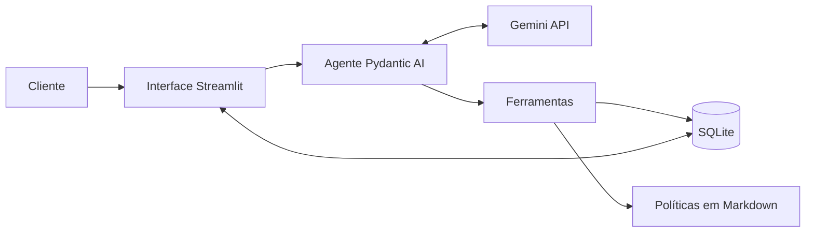
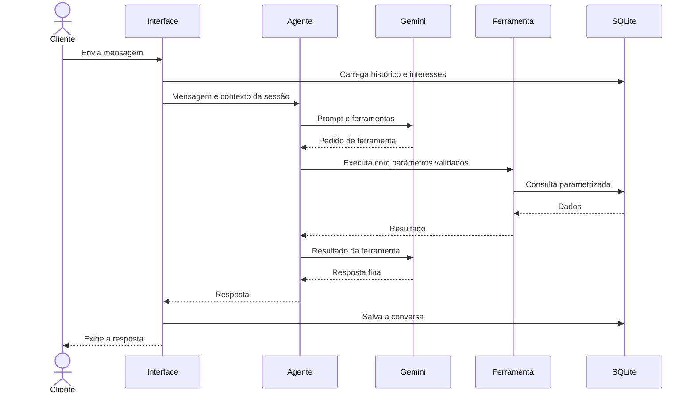

# Arquitetura

## 1. Visão geral

O sistema separa duas responsabilidades. O modelo de linguagem interpreta a mensagem, escolhe a ação e redige a resposta. O código Python consulta os dados, calcula valores e aplica as regras de privacidade.



## 2. Componentes

| Componente | Responsabilidade |
|---|---|
| Interface | Identificar o cliente, exibir a conversa e mostrar as ferramentas usadas |
| Agente | Reunir persona, regras, contexto, histórico e ferramentas |
| Ferramentas | Expor operações controladas sobre produtos, pedidos, políticas e encaminhamentos |
| Regras de negócio | Calcular disponibilidade, preço e descontos |
| Persistência | Guardar dados da loja, conversas, interesses e encaminhamentos |
| Carga de dados | Validar os arquivos de origem e recriar o banco local |

## 3. Fluxo de uma mensagem



## 4. Modelo de dados

Tabelas carregadas da origem: `categories`, `products`, `promotions`, `customers`, `orders` e `order_items`.

Tabelas operacionais:

| Tabela | Campos principais | Finalidade |
|---|---|---|
| `conversations` | `id`, `phone` (único), `created_at`, `updated_at` | Uma conversa contínua por telefone |
| `messages` | `id`, `conversation_id`, `content`, `created_at` | Guardar o histórico: cada linha é uma mensagem do Pydantic AI serializada em JSON |
| `conversation_state` | `phone` (chave), `pedido_em_analise`, `produto_em_foco`, `updated_at` | Estado pequeno da conversa, mantido em código (ADR-014) |
| `product_interests` | `id`, `phone`, `product_id`, `status`, `created_at`; único por `phone` e `product_id` | Acompanhar interesses em produtos (ADR-016) |
| `handoffs` | `id`, `phone`, `reason`, `summary`, `created_at` | Registrar encaminhamentos para a equipe (ADR-017) |

## 5. Decisões de arquitetura

### ADR-001: Function calling como padrão do agente

- **Status:** Aceita.
- **Contexto:** o agente precisa decidir quando consultar dados, políticas ou responder diretamente.
- **Decisão:** expor operações de negócio como ferramentas especializadas.
- **Alternativas:** agente de SQL, que amplia o risco de consultas indevidas; RAG para tudo, fraco em filtros exatos; regras fixas, limitadas diante da linguagem natural.
- **Consequências:** ganhamos controle e testabilidade. Novas capacidades exigem novas ferramentas.

### ADR-002: Pydantic AI como framework

- **Status:** Aceita.
- **Contexto:** o sistema tem um agente, algumas ferramentas e necessidade de testes sem chamadas reais.
- **Decisão:** usar Pydantic AI, com versão fixada.
- **Alternativas:** `google-genai`, que exigiria mais código de integração; LangGraph, mais adequado a fluxos com vários estados.
- **Consequências:** há menos código de integração e tipos explícitos. O projeto passa a depender da evolução do framework.

### ADR-003: Gemini 3.5 Flash-Lite como modelo

- **Status:** Aceita.
- **Contexto:** o MVP precisa de function calling, baixa latência e operação sem custo.
- **Decisão:** usar `gemini-3.5-flash-lite` no plano gratuito, com nome definido em configuração.
- **Validação:** em 31/10/2026, o modelo respondeu um pedido mínimo em 1,0 s e concluiu a consulta de preço com ferramenta em 3,2 s. No mesmo teste, `gemini-flash-latest` e `gemini-3.8-flash` não responderam em 40 s, `gemini-3.5-flash` levou 8,1 s e `gemini-2.5-flash` não estava disponível para a conta.
- **Alternativas:** modelos pagos, sem necessidade neste estágio; modelos locais, com maior esforço de instalação.
- **Consequências:** não há custo inicial. A cota limita testes e uso simultâneo, e os termos de uso de dados do plano devem ser revisados antes de qualquer dado real.

### ADR-011: Versões de modelo fixas

- **Status:** Aceita.
- **Contexto:** apelidos como `gemini-flash-latest` podem apontar para outro modelo sem aviso. Isso pode alterar o comportamento, a latência e o custo do atendimento sem nenhuma mudança no código. Em uma plataforma multi-tenant, o impacto alcançaria várias empresas ao mesmo tempo.
- **Decisão:** não usar apelidos como `latest`. O sistema deve configurar sempre um identificador de modelo explícito, em todos os ambientes.
- **Alternativas:** apelidos `latest`, que recebem melhorias automaticamente, mas tiram da equipe o controle sobre quando o comportamento muda.
- **Consequências:** toda troca de modelo passa a ser uma mudança deliberada, validada antes da implantação pelos testes e pela avaliação das respostas. A equipe precisa acompanhar a descontinuação de modelos e planejar as migrações. Um identificador explícito ainda pode ser atualizado pelo provedor, então a versão efetiva retornada na resposta deve ser monitorada em produção.

### ADR-012: Dados apresentados ao cliente traduzidos em código

- **Status:** Aceita.
- **Contexto:** o banco guarda códigos em inglês, como o status `shipped` do pedido. Na validação com o Gemini, o agente repassou o código ao cliente. Pedir ao modelo que traduza cada valor deixaria o resultado sujeito a variações e a erros sem relação com os dados.
- **Decisão:** uma camada em código traduz os dados do pedido antes de entregá-los ao agente. O código mantém o valor original (`status`), mas o modelo recebe apenas o texto em português (`situacao`): o campo original é excluído do retorno da ferramenta. O prompt manda o agente repetir a situação como veio. A tradução é um mapa fixo de 1 para 1, sem acrescentar significado que os dados não tenham: `pending` é "pendente", `confirmed` é "confirmado", `shipped` é "enviado", `delivered` é "entregue" e `cancelled` é "cancelado". A forma de pagamento já segue esse princípio.
- **Alternativas:** deixar o modelo traduzir, mais simples e menos confiável; substituir `status` pelo texto, o que perderia o registro original exigido pelo DQ-16 e pelo TC-301.
- **Consequências:** a tradução é testável sem chamar o modelo, e um novo status exige atualizar o mapa, o que a validação da carga (`docs/03-dados.md`, seção 8) já impede de passar despercebido. O modelo continua redigindo a frase, então o texto final ainda depende do prompt e da avaliação manual. O mesmo princípio vale para novos dados exibidos ao cliente: formatar em código, não pedir ao modelo.

### ADR-013: Arquitetura híbrida com guarda na saída

- **Status:** Aceita para o MVP.
- **Contexto:** o modelo escolhe a ferramenta e redige a resposta, então pode citar valores que a ferramenta não devolveu. As próximas issues (trocas, histórico, interesses, escopo) acrescentam regras e ferramentas, o que amplia essa superfície. Trocar a orquestração por uma em que o modelo só interpreta a intenção é possível, mas não cabe no prazo do MVP.
- **Decisão:** manter o function calling do ADR-001 e mover para o código tudo o que não depende de interpretação:
  1. **Fatos prontos.** Valores, datas, situações e vereditos de regra (como o prazo de devolução) são calculados e formatados em código. O modelo apenas os repassa (ADR-012).
  2. **Guarda na saída.** Antes de a resposta chegar ao cliente, o código confere se todo valor em reais, percentual, data e código de rastreio citado consta nos retornos das ferramentas daquele turno ou na própria mensagem do cliente. Datas são comparadas pelo dia, não pelo formato. Se algum valor não for confirmado, o modelo recebe um pedido de correção uma única vez. Persistindo o problema, o cliente recebe uma resposta segura, sem o texto do modelo. O mesmo validador remove da resposta, e do histórico guardado, blocos `<system>…</system>`, que são o raciocínio interno do modelo; um bloco aberto sem fechamento ou uma resposta que sobra vazia geram o mesmo pedido de correção.
  3. **Estado da conversa em código.** Os dados que precisam atravessar mensagens, como o pedido em análise e o produto em foco, ficam em uma estrutura pequena persistida por telefone, e não na memória do modelo (ADR-014).
  4. **Memória curta.** O modelo recebe apenas as últimas mensagens da conversa, cortadas em turnos inteiros, nunca uma chamada de ferramenta separada de seu retorno (ADR-014).
  5. **Dados mínimos.** Do cadastro, o modelo recebe só o primeiro nome.
- **Alternativas:** modelo que apenas interpreta, em duas etapas (primeira chamada devolve intenção e dados, o código executa as ferramentas e monta os fatos, a segunda redige). É mais previsível e usa sempre 2 requisições, mas exige reescrever a orquestração e foi adiada.
- **Consequências:** a guarda pega o erro mais perigoso, o valor inventado, sem custo quando a resposta está correta; cada correção custa uma requisição. Ela não detecta erro de interpretação, como confundir troca com arrependimento, nem números escritos por extenso. A evolução para duas etapas continua possível, porque as ferramentas e seus testes são reaproveitados.

### ADR-014: Histórico e estado da conversa persistidos por telefone

- **Status:** Aceita.
- **Contexto:** o cliente volta em outra sessão e espera continuar a conversa. Reenviar todo o histórico consome cota (ADR-008), e confiar na memória do modelo para saber qual pedido ou produto está em discussão deixa a conversa sujeita a esquecimentos. A API do modelo também rejeita uma conversa em que uma chamada de ferramenta aparece sem o seu retorno.
- **Decisão:**
  1. **Uma conversa por telefone.** O telefone normalizado por `src/phone.py` é a chave. Telefone inválido ou ausente não identifica ninguém: a conversa não é carregada nem salva e vale só para a tela aberta.
  2. **Mensagens.** Cada mensagem do Pydantic AI (`ModelRequest` ou `ModelResponse`) é serializada em JSON com `ModelMessagesTypeAdapter` e guardada em `messages`. O banco guarda o registro completo; o corte é feito na leitura. Uma linha ilegível descarta o que veio antes dela, em vez de travar o atendimento.
  3. **Regra de corte.** O modelo recebe no máximo 30 mensagens (eram 7 até a issue #14, o que só comportava um turno com ferramenta e fazia o agente esquecer o produto citado dois turnos antes). O corte começa no primeiro *turno* inteiro que cabe: um turno começa em uma fala do cliente que não responde a uma chamada de ferramenta, e vai até a próxima fala. Um turno que estoura o limite é descartado por completo. Com ferramenta, um turno tem 4 mensagens (fala, chamada, retorno, resposta) e cada rodada extra soma 2; 30 mensagens comportam cerca de 7 turnos com uma ferramenta, 3 turnos com três rodadas ou 15 turnos sem ferramenta. O custo é mais texto por requisição, e não mais requisições por dia. O corte é feito pelo próprio código ao carregar o histórico, e não por um *history processor* do Pydantic AI, porque o processador roda a cada chamada ao modelo dentro do turno e substitui o histórico da execução, o que poderia mexer nas fontes da guarda (ADR-013).
  4. **Guarda na saída.** Continua considerando só o turno atual (`fontes_do_turno`). Valores de mensagens antigas não sustentam respostas novas, mesmo estando no histórico enviado ao modelo.
  5. **Resposta segura.** Quando a guarda desiste, o código registra o encaminhamento (ADR-017) e o histórico guarda só a fala do cliente e a resposta segura, sem a tentativa rejeitada.
  6. **Estado.** A tabela `conversation_state` guarda, por telefone, `pedido_em_analise` (número do pedido) e `produto_em_foco` (id do produto). O código os preenche a partir dos retornos das ferramentas: um único pedido encontrado define o pedido em análise, e uma busca com um único produto define o produto em foco. Uma busca de produtos com vários resultados ou nenhum limpa o foco (ADR-016); a consulta de pedidos com vários resultados não altera o pedido em análise. Os dois campos entram no contexto dinâmico do prompt (ADR-007). Não há máquina de estados: cada campo é só um valor.
  7. **Sem chave estrangeira para a origem.** As tabelas operacionais não referenciam `products` nem `orders`, porque a carga recria essas tabelas. Os ids são validados pelo código que os grava (`CHECK` maior que zero).
- **Alternativas:** guardar o histórico inteiro em um único campo, o que impede o corte por mensagem; resumir conversas antigas com o modelo, o que gasta cota e pode inventar; deixar o modelo registrar o foco por conta própria, o que reabre o problema da memória.
- **Consequências:** a continuidade não depende do modelo, e o isolamento por telefone vale para histórico e estado. O pedido em análise só muda quando uma ferramenta devolve exatamente um resultado. Uma pergunta pendente no estado foi avaliada na issue #6 e descartada (ADR-015). O telefone digitado não prova identidade (ADR-009), então quem digitar o telefone de outra pessoa vê a conversa dela; em produção, o canal autenticado resolve isso.

### ADR-015: Veredito de troca e devolução em código

- **Status:** Aceita.
- **Contexto:** o prazo de devolução depende do status do pedido, do motivo, do canal de compra e de datas. Calcular isso na resposta do modelo arrisca prazos errados. Os dados não têm canal de compra nem data real de entrega (DQ-17), e a data de entrega estimada é a melhor aproximação.
- **Decisão:**
  1. **Ferramenta `avaliar_devolucao`.** O modelo informa o pedido, o motivo (`arrependimento`, `defeito` ou `preferencia`) e, quando souber, o canal (`online` ou `presencial`). O código (`src/returns.py`) devolve um `Veredito` pronto: resultado geral, regras avaliadas com o prazo final já formatado, o que falta perguntar, avisos e as datas de recebimento e de referência. O modelo repassa o veredito e não calcula prazos. O cliente vem da sessão, e pedido de outro cliente volta como não encontrado.
  2. **Regras.** Arrependimento: 7 dias após o recebimento, só em compra online (DQ-24); sem o canal, o veredito pede o canal. Defeito: troca em 30 dias corridos da compra e garantia legal em 90 dias do recebimento, avaliadas separadamente (DQ-23). Preferência: 7 dias após o recebimento (DQ-26). O pedido é consultado antes de qualquer outra regra: pedido inexistente ou de outro cliente é `pedido_nao_encontrado`, com qualquer motivo ou canal, e só um pedido do cliente chega ao estado. Pedidos pendentes, confirmados ou cancelados não têm produto recebido, e o resultado é `nao_se_aplica`, assim como o arrependimento em compra presencial, com um aviso que explica o motivo. Se a entrega estimada ainda não passou, o veredito avisa que o prazo só conta do recebimento. O recebimento é a entrega estimada, e o veredito sempre avisa que é uma aproximação. O resultado vale para o prazo: a aprovação depende da análise do produto, e um aviso diz isso.
  3. **Data de referência.** `DATA_DE_REFERENCIA` (padrão 2026-03-25), lida por `config.data_de_referencia()`. A `Sessao` a carrega no campo `hoje`, e o teste informa a data que precisa.
  4. **Sem pergunta pendente no estado.** Quando o veredito traz algo em `faltando`, o modelo faz a pergunta e ela fica no histórico (ADR-014), que o modelo já recebe. Um campo no estado duplicaria o histórico e podia fazer o agente insistir na pergunta quando o cliente muda de assunto. O estado guarda só fatos (`pedido_em_analise` e `produto_em_foco`), e a ferramenta atualiza o pedido em análise. O prompt manda seguir o novo assunto sem repetir a pergunta.
  5. **Datas em formato brasileiro.** Datas apresentadas ao cliente, nos pedidos e nos vereditos, saem de `src/datas.py` como `dd/mm/aaaa` (ADR-012). A guarda compara datas pelo dia e continua aceitando o formato ISO.
  6. **Tipos.** `Motivo`, `Canal` e `Resultado` são `StrEnum`: o Pydantic valida os argumentos do modelo e o JSON mantém o texto. Disponibilidade, status do pedido e preços seguem como texto, porque só circulam até o modelo. Um tipo `Dinheiro` não entrou, porque os novos cálculos são de datas e não há conta nova com valores.
  7. **Sem migração.** O esquema de `conversation_state` não mudou. Um banco que tenha uma coluna `pergunta_pendente`, criada por uma versão intermediária, continua funcionando: a coluna é opcional e o código não a usa.
- **Alternativas:** deixar o modelo comparar datas, que reabre o risco de prazos inventados; perguntar o canal sempre, o que incomoda quem só quer saber o prazo de um defeito.
- **Consequências:** o veredito é testável sem o modelo. A escolha do motivo, a leitura de respostas curtas do cliente ("foi online") e a decisão de seguir um novo assunto continuam com o modelo e dependem do prompt e da avaliação manual. O recebimento aproximado pode errar o prazo em alguns dias, e o aviso encaminha o cliente à equipe quando a data real for diferente.

### ADR-016: Interesses por telefone e reposição simulada

- **Status:** Aceita.
- **Contexto:** o cliente quer retomar, em outro dia, o assunto de um produto indisponível ("chegou o violão?"), sem que o agente prometa data de reposição (RA-03, DQ-18). O histórico é cortado (ADR-014), então não garante a lembrança do produto.
- **Decisão:**
  1. **Tabela própria.** `product_interests` (`phone`, `product_id`, `status`, `created_at`), separada do histórico (ADR-008). `status` aceita só `pending` (`CHECK`), `product_id` é maior que zero (`CHECK`) e há `UNIQUE (phone, product_id)`. Sem chave estrangeira para `products`, que a carga recria; o código valida a existência do produto. A tabela nasce com `CREATE TABLE IF NOT EXISTS` e a carga nunca a recria, então não há migração.
  2. **Gravação em `src/interests.py`.** `registrar` normaliza o telefone e devolve `registrado`, `ja_registrado`, `produto_inexistente` ou `telefone_invalido`; só `registrado` grava. Repetir o pedido, com qualquer formatação do telefone, não duplica (TC-402).
  3. **Quem pode registrar.** Qualquer telefone válido, mesmo sem cadastro em `customers`: como no histórico (ADR-014), o telefone identifica a conversa, e o cadastro só é exigido para pedidos. Telefone inválido ou ausente não grava nada.
  4. **Ferramenta `registrar_interesse(product_id)`.** O telefone vem da sessão e nunca do modelo (ADR-009): um argumento extra como `phone` é recusado. O retorno é um texto fixo, montado em código, que diz que o registro não reserva o produto nem garante aviso ou data. Registrar define o produto em foco.
  5. **Contexto dinâmico.** O prompt recebe `Interesses pendentes:` com apenas os nomes dos 5 interesses mais recentes, com um aviso quando há mais antigos, lidos pelo telefone da sessão (dados mínimos, ADR-013). Sem interesses, o contexto diz `nenhum`. Disponibilidade e preço não entram no contexto: o prompt manda consultar `buscar_produtos` de novo, e o código calcula a disponibilidade atual. A guarda continua exigindo que os valores citados venham do turno.
  6. **Foco.** Uma busca com vários resultados ou nenhum limpa `produto_em_foco`; um resultado único o define. É só um valor, sem máquina de estados. Evita que "o preço dele" se refira a um produto antigo depois de uma lista.
  7. **Reposição simulada.** `scripts/simulate_restock.py <produto> [--quantidade N] [--banco caminho]` soma a quantidade ao estoque no banco local (padrão: 5 unidades, `data/emporio.db`). Recusa produto inexistente, quantidade menor que 1 e produto que não esteja `active` (o status tem prioridade sobre o estoque), e não cria o banco se ele não existir. Os CSVs não são tocados. `python -m src.load_data` recria `products` a partir dos CSVs e devolve o estoque original; interesses e conversas são preservados.
- **Alternativas:** ferramenta `consultar_meus_interesses`, que custaria uma chamada a mais por pergunta; incluir a disponibilidade no contexto, que a deixaria desatualizada e fora da guarda; exigir cadastro para registrar interesse, o que impediria um cliente novo de retomar o assunto.
- **Consequências:** a retomada não depende do histórico, e o isolamento por telefone vale também para interesses. A escolha de registrar e de consultar de novo continua com o modelo e depende do prompt e da avaliação manual. Não há aviso automático de reposição (fora do escopo). Um telefone digitado não prova identidade (ADR-009): quem digitar o telefone de outra pessoa vê os interesses dela.

### ADR-017: Encaminhamento para a equipe

- **Status:** Aceita.
- **Contexto:** reclamações, pedidos de atendente e perguntas sem resposta segura precisam chegar à equipe com motivo e resumo (RF-10), e o cliente precisa saber quando terá retorno. Deixar isso só com o modelo arrisca "registros" que nunca foram gravados e prazos inventados.
- **Decisão:**
  1. **Tabela `handoffs`.** `phone`, `reason`, `summary` e `created_at`. `reason` aceita `reclamacao`, `sem_resposta_segura` e `atendente_solicitado` (`CHECK`), e `summary` não pode ser vazio (`CHECK`). Sem chave estrangeira; a carga nunca a recria, então não há migração.
  2. **Gravação em `src/handoffs.py`.** `registrar` normaliza o telefone, corta o resumo em 500 caracteres e devolve `registrado`, `ja_registrado` (mesmo telefone, motivo e resumo), `resumo_invalido` ou `telefone_invalido`. Só `registrado` grava.
  3. **Ferramenta `encaminhar_para_atendente(motivo, resumo)`.** O telefone vem da sessão e nunca do modelo (ADR-009). O retorno é um texto fixo, e o prazo de 24 horas úteis é montado em código (`src/agent.py`, `MENSAGENS_DE_ENCAMINHAMENTO`).
  4. **Sem telefone válido.** Nada é gravado, porque a equipe não teria como retornar (como nos interesses, ADR-016). A ferramenta devolve uma mensagem que manda o modelo explicar que o telefone não foi identificado e passar os contatos da loja.
  5. **Resposta segura da guarda (ADR-013).** Quando a guarda desiste, o código registra um encaminhamento `sem_resposta_segura` com a fala do cliente como resumo, sem depender do modelo, e a resposta informa o prazo de retorno. Sem telefone válido, a resposta explica que não foi possível identificar o telefone para encaminhar o caso; com uma mensagem vazia, nada é gravado e a resposta não afirma registro. O histórico guarda o mesmo texto que o cliente recebeu.
  6. **Devolução fora do prazo.** O agente avisa que o prazo expirou e oferece falar com um atendente, pelos contatos da loja ou pelo encaminhamento. Só registra se o cliente aceitar.
  7. **Escopo.** A recusa de assuntos fora do escopo, o redirecionamento de acessórios, a resistência a pedidos para ignorar regras e a ausência de promessas de desconto são regras de prompt, avaliadas manualmente (`docs/05-testes-e-roteiro.md`, seção 9.2). Nenhuma ferramenta expõe dados de outros clientes.
- **Alternativas:** deixar o modelo registrar também a resposta segura, o que depende de ele cumprir o prompt justamente quando a resposta falhou; registrar sem telefone, o que gera casos sem retorno possível.
- **Consequências:** o registro da resposta segura é garantido em código, e os demais dependem de o modelo chamar a ferramenta. O resumo guarda texto livre do cliente e é tratado como dado pessoal (`docs/03-dados.md`, seção 7). Não há painel nem leitura dos encaminhamentos: a equipe consulta a tabela (fora do escopo do MVP). Um encaminhamento repetido com resumo diferente gera outro registro.

### ADR-018: Resiliência a falhas do provedor e painel de ferramentas

- **Status:** Aceita.
- **Contexto:** o plano gratuito do Gemini tem limite de uso baixo (20 requisições por dia consideradas), e o provedor pode ficar lento ou fora do ar. Sem tratamento, o cliente via um traceback e a fala dele se perdia. A equipe de desenvolvimento também precisa ver quais ferramentas o agente usou em cada resposta.
- **Decisão:**
  1. **Nova tentativa em código.** `responder` repete a execução quando o provedor recusa por limite de uso (`ModelRateLimitError`) ou está indisponível ou sobrecarregado (`ModelUnavailableError`, `ModelOverloadedError`), e também quando o servidor falha (`ModelServerError`, como 500, 502 e 504): no máximo 2 repetições, esperando o `retry_after` do provedor com teto de 15 s, ou 2 s e 5 s sem ele. O laço fica no código e não no `max_retries` do SDK, para ser visível e testável sem a API. Cada repetição consome uma requisição da cota. Como a execução recomeça do histórico, as ferramentas do turno rodam de novo; as de gravação são idempotentes (interesses e encaminhamentos não duplicam).
  2. **Sem repetição.** Cota esgotada (`ModelQuotaExceededError`) e tempo esgotado não se resolvem esperando.
  3. **Tempo limite.** `model_settings` do agente define `timeout=20` por tentativa e `request_timeout=40` por requisição. `ModelTimeoutError` e `ModelRequestTimeout` geram `MENSAGEM_DE_TIMEOUT`.
  4. **Mensagens ao cliente.** Limite persistente, cota esgotada e indisponibilidade geram `MENSAGEM_DE_LIMITE`. Qualquer outra falha do provedor (rede, chave, 5xx persistente), do banco ou uma exceção inesperada gera `MENSAGEM_DE_ERRO_TECNICO`, sem detalhes técnicos, que vão para o log (`logging`); a captura final de `responder` garante que nenhuma exceção chegue à tela. As ferramentas recusam valores acima de R$ 1.000.000 e números de pedido ou produto acima de 2³¹−1, que estouravam o cálculo ou o inteiro do SQLite. Em todos os casos a fala do cliente e a mensagem enviada entram no histórico, no mesmo molde da resposta segura, e uma falha ao gravar não derruba o atendimento. A resposta segura (ADR-013) também tolera falha do banco ao registrar o encaminhamento.
  5. **Limite efetivo.** `src/limits.py` acrescenta uma linha JSON a `data/limites_provedor.log` (fora do Git) quando um erro de limite persiste: data, modelo, status, `retry_after` e, quando o corpo do erro do Gemini traz, a métrica, a cota e o valor do limite. Não há telefone nem texto do cliente. Uma falha ao gravar o arquivo não impede a mensagem.
  6. **Painel de ferramentas.** `responder` preenche `Sessao.ferramentas` com as chamadas do turno (nome e argumentos), reiniciada a cada turno. A interface mostra um bloco "Ferramentas usadas" em cada resposta recebida na tela aberta; as respostas recarregadas pelo telefone não têm o painel.
  7. **Mensagens em sequência.** A interface anexa a fala e a resposta ao estado da tela antes de qualquer chamada de desenho. Esse ajuste não impediu que uma mensagem enviada durante a resposta deixasse a anterior sem resposta; o bloqueio do campo (ADR-020) o substitui como solução.
- **Alternativas:** `max_retries` do SDK, escondido e não testável offline; tabela para o registro de limites, descartada pela simplicidade; persistir as ferramentas no histórico para o painel também aparecer nas respostas antigas.
- **Consequências:** o cliente nunca vê um traceback nas falhas previstas, e a conversa não se perde. Cada repetição gasta cota, e uma espera de até 22 s soma-se ao tempo de resposta. O registro de limites depende de o provedor informar os dados. Uma requisição interrompida no provedor ainda pode ter sido processada, o que aceitamos no MVP.

### ADR-019: Busca de produtos com tolerância a erro de digitação

- **Status:** Aceita.
- **Contexto:** a busca ignorava maiúsculas e acentos, mas não erros de digitação: "gianini gf 3d" não encontrava o Giannini GF-3D, e o agente deixava de definir o produto em foco.
- **Decisão:** `buscar_produtos` faz primeiro a busca exata. Só quando ela não encontra nada, repete a busca aceitando, em cada palavra do termo, uma letra a mais, a menos ou trocada em relação a uma palavra do nome. A tolerância vale apenas para palavras formadas só por letras e com 5 letras ou mais; palavras curtas e códigos de modelo, que têm dígitos ou hífen (`F310`, `GF-3D`, `D-28E`), continuam exatos.
- **Ampliação (issue #14):** cada palavra da consulta também casa com a categoria do produto no singular ("violão takamine", "ukulele kala", "guitarra stratocaster fender"), palavras de ligação ("da", "do", "um") são ignoradas, e a comparação exata não conta o hífen ("GF3D", "Martin D28", "AC39", "KAC"). Uma consulta só com palavras de ligação não devolve o catálogo. Códigos continuam sem aproximação: "D28E" não traz o D-28.
- **Alternativas:** distância de edição maior ou por trigramas, descartadas por aproximarem modelos distintos; delegar a correção ao modelo, descartada porque o preço e o estoque devem vir de uma busca determinística.
- **Consequências:** nomes escritos errado passam a ser encontrados sem tocar o caminho exato. Um erro em código de modelo ou em palavra curta continua sem resultado, o que evita responder sobre o produto errado.

### ADR-020: Campo de mensagem bloqueado enquanto o Tom responde

- **Status:** Aceita.
- **Contexto:** no Streamlit, uma nova mensagem interrompe a execução em andamento. Na validação com a interface real, uma segunda mensagem enviada durante a resposta da primeira deixou a primeira sem resposta na tela, e a chamada ao Gemini continuou sem destino.
- **Decisão:** a interface roda em duas execuções. Ao enviar, a pergunta entra no estado da tela como pendente e a tela é recarregada com o campo desabilitado. A segunda execução responde à pendência, guarda a resposta e recarrega a tela com o campo liberado. Durante a espera o spinner diz "O Tom está digitando...", sem pausa artificial.
- **Alternativas:** agrupar as mensagens recebidas numa janela de 2 a 5 segundos e enviar todas juntas ao agente (debounce), descartada no MVP porque soma a espera a toda mensagem e não cobre uma mensagem que chega durante a chamada ao modelo; aceitar a limitação, descartada porque perde respostas.
- **Consequências:** nenhuma mensagem fica sem resposta, ao custo de o cliente só poder escrever depois da resposta (de poucos segundos a cerca de 22 s quando há nova tentativa). O agrupamento de mensagens por telefone fica para a integração com um canal como o WhatsApp, onde o servidor recebe as mensagens e a fila é natural. Uma recarga da página durante a espera perde a pergunta pendente, porque o estado da tela é da sessão. A pergunta pendente guarda o telefone de quem a enviou: se o campo de telefone mudar durante a espera, a resposta é guardada para o telefone original e não aparece na conversa exibida do novo número. Se a resposta falhar com uma exceção inesperada, a pendência é limpa, o campo é liberado e a tela mostra `MENSAGEM_DE_ERRO_TECNICO` em vez do traceback; o detalhe vai para o log. O Streamlit também roda com `showErrorDetails = "none"` (`.streamlit/config.toml`).

### ADR-021: Respostas só com informação de fonte conhecida

- **Status:** Aceita.
- **Contexto:** uma avaliação de QA mostrou o Tom inventando especificações, estoque, fatos da loja e promessas de aviso, e supondo o canal de compra. A guarda do ADR-013 só confere valores em reais, percentuais, datas e rastreios.
- **Decisão:**
  1. **Especificações pelo cadastro.** A carga passa a guardar `specs` (JSON de `products.csv`) e `Produto.especificacoes` as devolve ao modelo. A descrição livre não é exposta (DQ-04). Campos que o cadastro contradiz ficam de fora: `strings` do Yamaha Bass 3X, id 137 (DQ-05). O que não estiver nas especificações é respondido como "não tenho essa informação".
  2. **Quantidade sem estoque exato.** `buscar_produtos` aceita `quantidade` e devolve `atende_quantidade`, calculado em código: só é verdadeiro para produto disponível com estoque suficiente (o `status` tem prioridade, DQ-02 e DQ-03). O número do estoque não é exposto, porque muda a cada venda e vira promessa; o Tom nunca cita nem estima unidades.
  3. **Canal só se o cliente citou.** `avaliar_devolucao` ignora o `canal` quando nenhuma fala do cliente na conversa traz uma palavra desse canal (online, site, internet, presencial, pessoalmente, na loja, balcão). O veredito volta `faltam_dados` e o Tom pergunta. A busca usa palavras inteiras e frases (`online`, `pelo site`, `pela internet`, `presencial`, `na loja`), porque "site" sozinho pode ser só uma consulta de preço. A conversa inteira conta, inclusive falas de turnos anteriores.
  4. **Promessa de aviso na guarda.** O validador de saída recusa respostas que prometem avisar o cliente (ADR-016), exceto quando negam a promessa em até 25 caracteres antes. O retorno da equipe prometido pelo encaminhamento ("entraremos em contato", ADR-017) não é barrado. O modelo recebe um pedido de correção.
  5. **Regras de prompt.** O prompt ganha regras para especificação e quantidade, assuntos sem fonte (categorias, serviços, lojas parceiras, exceções de prazo, cidade do cliente, site e carrinho), compra, reserva, cancelamento e alteração de pedido. Elas dependem do comportamento do Gemini: **não têm teste automático**, por decisão registrada, porque um teste sobre o texto do prompt só confirmaria que a frase existe. São validadas à mão com o Gemini (docs/05, seção 9.2). O frete de exatamente R$ 500,00, que o manual não cobre, e o cancelamento de uma devolução inexistente dependem só do prompt.
  6. **Carga desatualizada.** Um banco carregado antes das especificações é tratado como não carregado e a tela indica `python -m src.load_data`.
- **Alternativas:** expor o estoque exato, descartada; dispensar as regras de prompt e tratar tudo por código, fora do prazo do MVP; teste automático sobre o texto do prompt, tautológico.
- **Consequências:** o Tom passa a ter dados para responder sobre especificações e quantidade sem inventar, e o canal deixa de ser suposto. As listas de palavras do canal e de frases de aviso são heurísticas e não cobrem toda redação. As chaves das especificações vêm em inglês (`back_sides`, `neck`) e o modelo as traduz. As regras de prompt só foram avaliadas com modelo simulado até a cota do Gemini voltar.

### ADR-022: Data de referência no contexto e atraso do pedido calculado em código

- **Status:** Aceita.
- **Contexto:** o agente não recebia a data, apesar de a especificação prever, e respondeu que um pedido enviado com previsão vencida há 25 dias "não estava atrasado". Perguntas como "a loja abre amanhã?" também ficavam sem resposta.
- **Decisão:**
  1. O contexto de cada turno traz "Hoje: dd/mm/aaaa, dia da semana", calculado em código a partir da data de referência da sessão, e diz que o sistema não informa a hora atual.
  2. A guarda de saída (ADR-013) aceita a data de hoje como fonte, além das ferramentas e da fala do cliente.
  3. `consultar_meus_pedidos` devolve, em `atraso`, o texto pronto "A entrega estimada era … e o pedido segue como enviado: N dias de atraso" quando o pedido está enviado e a previsão venceu (DQ-16). Pedido no prazo, entregue, pendente ou confirmado não traz o campo.
  4. "A loja está aberta agora?" é respondida com o dia da semana e o horário do manual, informando que a hora atual não está disponível. "Abrem amanhã?" usa o dia da semana seguinte. Essas respostas dependem do prompt (docs/05, seção 9.2).
- **Alternativas:** ler o relógio do sistema, descartada porque a data de referência dos dados é fixa e a hora real contradiria os prazos calculados; deixar o modelo comparar as datas, descartada pelo erro observado.
- **Consequências:** o atraso e o dia da semana deixam de depender do modelo. A hora atual continua indisponível, então "aberta agora" não tem resposta definitiva. O texto do atraso só cobre pedidos enviados; pedidos confirmados sem previsão não têm atraso calculável.

### ADR-004: SQLite como armazenamento

- **Status:** Aceita.
- **Contexto:** os dados chegam em CSV, e o sistema também precisa persistir conversas.
- **Decisão:** carregar os CSVs em SQLite e usar o mesmo banco para os dados operacionais.
- **Alternativas:** leitura direta com pandas, sem persistência para conversas; PostgreSQL, com operação desnecessária no MVP.
- **Consequências:** o ambiente é simples e reprodutível. Uso concorrente em produção exigiria migração.

### ADR-005: Consultas fixas e parametrizadas

- **Status:** Aceita.
- **Contexto:** filtros de disponibilidade e privacidade não podem depender do modelo.
- **Decisão:** o modelo escolhe parâmetros, mas não escreve SQL.
- **Consequências:** o comportamento é auditável. Perguntas analíticas livres ficam fora do MVP.

### ADR-006: Consulta de políticas por seção

- **Status:** Aceita.
- **Contexto:** o manual tem 8 páginas, e a extração automática desalinha tabelas, como a de horários.
- **Decisão:** manter uma versão revisada em Markdown, consultada por seção.
- **Alternativas:** banco vetorial, que adiciona componentes sem ganho relevante para este volume.
- **Consequências:** a recuperação é previsível e barata. O arquivo precisa ser mantido junto com o manual, e um manual muito maior exigiria reavaliar a busca semântica.

### ADR-007: Prompt em duas partes

- **Status:** Aceita.
- **Contexto:** o agente precisa de comportamento estável e de informações específicas de cada conversa.
- **Decisão:** separar instruções fixas, com persona e regras, de um contexto dinâmico com data, cliente e interesses pendentes. Usar temperatura baixa e descrições claras nas ferramentas.
- **Consequências:** o prompt fica mais curto e fácil de manter. Regras críticas continuam garantidas em código.

### ADR-008: Memória estruturada de interesses

- **Status:** Aceita.
- **Contexto:** reenviar todo o histórico consome cota e não garante a recuperação de uma informação antiga.
- **Decisão:** limitar o histórico enviado ao modelo e guardar interesses em `product_interests`.
- **Consequências:** o dado de negócio persiste entre conversas. O agente precisa registrar o interesse corretamente.

### ADR-009: Identificação pela sessão

- **Status:** Aceita para o MVP.
- **Contexto:** consultas de pedidos precisam respeitar o titular dos dados.
- **Decisão:** resolver o cliente a partir do telefone da sessão e nunca aceitar `customer_id` como argumento do modelo.
- **Consequências:** uma mensagem não troca o titular da consulta. Como o telefone digitado não prova identidade, produção exige identificação pelo canal autenticado.

### ADR-010: Streamlit como interface

- **Status:** Aceita.
- **Contexto:** o MVP precisa de um chat web simples, mantido em Python.
- **Decisão:** usar Streamlit.
- **Alternativas:** FastAPI com front-end próprio, que exigiria mais desenvolvimento.
- **Consequências:** a entrega é rápida. Um canal de produção exigirá outra camada de entrada.

## 6. Segurança e privacidade

- Chaves ficam em variáveis de ambiente, fora do Git.
- Consultas usam parâmetros, nunca concatenação de texto.
- Pedidos são filtrados pelo cliente da sessão.
- Mensagens e documentos são tratados como dados, não como instruções do sistema.
- Dados pessoais são limitados ao necessário para cada resposta.

## 7. Estrutura de diretórios

```text
.
├── app.py                  # Interface Streamlit
├── src/
│   ├── agent.py            # Agente, prompt e ferramentas
│   ├── catalog.py          # Busca, disponibilidade e preços
│   ├── config.py           # Configurações
│   ├── database.py         # Conexão com o banco
│   ├── load_data.py        # Validação e carga dos dados
│   ├── memory.py           # Histórico e estado da conversa por telefone
│   ├── limits.py           # Registro dos limites informados pelo provedor
│   ├── returns.py          # Veredito de prazos de troca e devolução
│   ├── datas.py            # Formatação de datas para o cliente
│   └── policies.py         # Leitura das políticas
├── scripts/
│   └── simulate_restock.py # Simula uma reposição de estoque
├── data/
│   ├── *.csv               # Dados de origem
│   ├── políticas_da_loja.pdf
│   └── politicas.md        # Políticas revisadas
├── examples/               # Conversas de referência
├── tests/
└── docs/
```

## 8. Evolução para produção

| Tema | Evolução |
|---|---|
| Canal | Integrar com a API oficial do WhatsApp |
| Identidade | Usar o número autenticado pelo canal |
| Dados | Integrar com ERP e sistema de pedidos |
| Banco | Migrar para PostgreSQL |
| Observabilidade | Registrar métricas de uso, falhas e transferências para humanos |
| Qualidade | Adotar avaliações contínuas das respostas |

## 9. Referências

- [Pydantic AI: modelos Google](https://github.com/pydantic/pydantic-ai/blob/main/docs/models/google.md)
- [Pydantic AI: histórico de mensagens](https://github.com/pydantic/pydantic-ai/blob/main/docs/message-history.md)
- [SDK Python do Google Gen AI](https://googleapis.github.io/python-genai/)
- [LangGraph: checkpointers](https://docs.langchain.com/oss/python/langgraph/checkpointers)
- [Gemini API: limites de uso](https://ai.google.dev/gemini-api/docs/rate-limits)
- [Gemini API: preços](https://ai.google.dev/gemini-api/docs/pricing)
