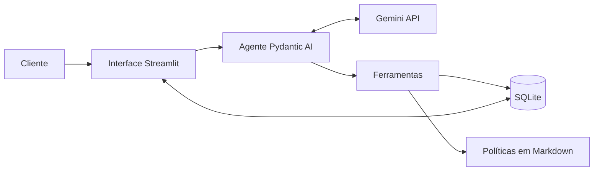
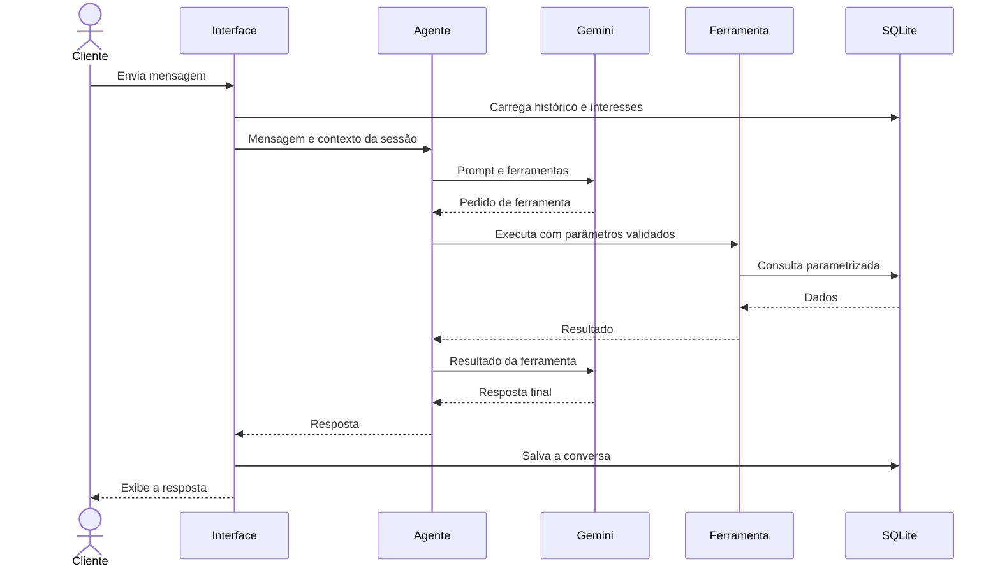

# Arquitetura

## 1. Visão geral

O sistema separa duas responsabilidades. O modelo de linguagem interpreta a mensagem, escolhe a ação e redige a resposta. O código Python consulta os dados, calcula valores e aplica as regras de privacidade.



## 2. Componentes

| Componente | Responsabilidade |
|---|---|
| Interface | Identificar o cliente, exibir a conversa e mostrar as ferramentas usadas |
| Agente | Reunir persona, regras, contexto, histórico e ferramentas |
| Ferramentas | Expor operações controladas sobre produtos, pedidos, políticas e encaminhamentos |
| Regras de negócio | Calcular disponibilidade, preço e descontos |
| Persistência | Guardar dados da loja, conversas, interesses e encaminhamentos |
| Carga de dados | Validar os arquivos de origem e recriar o banco local |

## 3. Fluxo de uma mensagem



## 4. Modelo de dados

Tabelas carregadas da origem: `categories`, `products`, `promotions`, `customers`, `orders` e `order_items`.

Tabelas operacionais:

| Tabela | Campos principais | Finalidade |
|---|---|---|
| `conversations` | `id`, `phone`, `created_at`, `updated_at` | Agrupar conversas por telefone |
| `messages` | `id`, `conversation_id`, `content`, `created_at` | Guardar o histórico serializado |
| `product_interests` | `id`, `phone`, `product_id`, `status`, `created_at` | Acompanhar interesses em produtos |
| `handoffs` | `id`, `phone`, `reason`, `summary`, `created_at` | Registrar encaminhamentos para a equipe |

## 5. Decisões de arquitetura

### ADR-001: Function calling como padrão do agente

- **Status:** Aceita.
- **Contexto:** o agente precisa decidir quando consultar dados, políticas ou responder diretamente.
- **Decisão:** expor operações de negócio como ferramentas especializadas.
- **Alternativas:** agente de SQL, que amplia o risco de consultas indevidas; RAG para tudo, fraco em filtros exatos; regras fixas, limitadas diante da linguagem natural.
- **Consequências:** ganhamos controle e testabilidade. Novas capacidades exigem novas ferramentas.

### ADR-002: Pydantic AI como framework

- **Status:** Aceita.
- **Contexto:** o sistema tem um agente, algumas ferramentas e necessidade de testes sem chamadas reais.
- **Decisão:** usar Pydantic AI, com versão fixada.
- **Alternativas:** `google-genai`, que exigiria mais código de integração; LangGraph, mais adequado a fluxos com vários estados.
- **Consequências:** há menos código de integração e tipos explícitos. O projeto passa a depender da evolução do framework.

### ADR-003: Gemini Flash como modelo

- **Status:** Aceita, com versão a definir.
- **Contexto:** o MVP precisa de function calling e deve operar sem custo.
- **Decisão:** usar um modelo Gemini Flash no plano gratuito, com nome definido em configuração.
- **Alternativas:** modelos pagos, sem necessidade neste estágio; modelos locais, com maior esforço de instalação.
- **Consequências:** não há custo inicial. A cota limita testes e uso simultâneo, e os termos de uso de dados do plano devem ser revisados antes de qualquer dado real.

### ADR-004: SQLite como armazenamento

- **Status:** Aceita.
- **Contexto:** os dados chegam em CSV, e o sistema também precisa persistir conversas.
- **Decisão:** carregar os CSVs em SQLite e usar o mesmo banco para os dados operacionais.
- **Alternativas:** leitura direta com pandas, sem persistência para conversas; PostgreSQL, com operação desnecessária no MVP.
- **Consequências:** o ambiente é simples e reprodutível. Uso concorrente em produção exigiria migração.

### ADR-005: Consultas fixas e parametrizadas

- **Status:** Aceita.
- **Contexto:** filtros de disponibilidade e privacidade não podem depender do modelo.
- **Decisão:** o modelo escolhe parâmetros, mas não escreve SQL.
- **Consequências:** o comportamento é auditável. Perguntas analíticas livres ficam fora do MVP.

### ADR-006: Consulta de políticas por seção

- **Status:** Aceita.
- **Contexto:** o manual tem 8 páginas, e a extração automática desalinha tabelas, como a de horários.
- **Decisão:** manter uma versão revisada em Markdown, consultada por seção.
- **Alternativas:** banco vetorial, que adiciona componentes sem ganho relevante para este volume.
- **Consequências:** a recuperação é previsível e barata. O arquivo precisa ser mantido junto com o manual, e um manual muito maior exigiria reavaliar a busca semântica.

### ADR-007: Prompt em duas partes

- **Status:** Aceita.
- **Contexto:** o agente precisa de comportamento estável e de informações específicas de cada conversa.
- **Decisão:** separar instruções fixas, com persona e regras, de um contexto dinâmico com data, cliente e interesses pendentes. Usar temperatura baixa e descrições claras nas ferramentas.
- **Consequências:** o prompt fica mais curto e fácil de manter. Regras críticas continuam garantidas em código.

### ADR-008: Memória estruturada de interesses

- **Status:** Aceita.
- **Contexto:** reenviar todo o histórico consome cota e não garante a recuperação de uma informação antiga.
- **Decisão:** limitar o histórico enviado ao modelo e guardar interesses em `product_interests`.
- **Consequências:** o dado de negócio persiste entre conversas. O agente precisa registrar o interesse corretamente.

### ADR-009: Identificação pela sessão

- **Status:** Aceita para o MVP.
- **Contexto:** consultas de pedidos precisam respeitar o titular dos dados.
- **Decisão:** resolver o cliente a partir do telefone da sessão e nunca aceitar `customer_id` como argumento do modelo.
- **Consequências:** uma mensagem não troca o titular da consulta. Como o telefone digitado não prova identidade, produção exige identificação pelo canal autenticado.

### ADR-010: Streamlit como interface

- **Status:** Aceita.
- **Contexto:** o MVP precisa de um chat web simples, mantido em Python.
- **Decisão:** usar Streamlit.
- **Alternativas:** FastAPI com front-end próprio, que exigiria mais desenvolvimento.
- **Consequências:** a entrega é rápida. Um canal de produção exigirá outra camada de entrada.

## 6. Segurança e privacidade

- Chaves ficam em variáveis de ambiente, fora do Git.
- Consultas usam parâmetros, nunca concatenação de texto.
- Pedidos são filtrados pelo cliente da sessão.
- Mensagens e documentos são tratados como dados, não como instruções do sistema.
- Dados pessoais são limitados ao necessário para cada resposta.

## 7. Estrutura de diretórios

```text
.
├── app.py                  # Interface Streamlit
├── src/
│   ├── agent.py            # Agente, prompt e ferramentas
│   ├── config.py           # Configurações
│   ├── database.py         # Conexão e consultas
│   ├── load_data.py        # Validação e carga dos dados
│   ├── policies.py         # Leitura das políticas
│   └── pricing.py          # Regras de preço
├── scripts/
│   └── simulate_restock.py # Simula uma reposição de estoque
├── data/
│   ├── *.csv               # Dados de origem
│   ├── políticas_da_loja.pdf
│   └── politicas.md        # Políticas revisadas
├── examples/               # Conversas de referência
├── tests/
└── docs/
```

## 8. Evolução para produção

| Tema | Evolução |
|---|---|
| Canal | Integrar com a API oficial do WhatsApp |
| Identidade | Usar o número autenticado pelo canal |
| Dados | Integrar com ERP e sistema de pedidos |
| Banco | Migrar para PostgreSQL |
| Observabilidade | Registrar métricas de uso, falhas e transferências para humanos |
| Qualidade | Adotar avaliações contínuas das respostas |

## 9. Referências

- [Pydantic AI: modelos Google](https://github.com/pydantic/pydantic-ai/blob/main/docs/models/google.md)
- [Pydantic AI: histórico de mensagens](https://github.com/pydantic/pydantic-ai/blob/main/docs/message-history.md)
- [SDK Python do Google Gen AI](https://googleapis.github.io/python-genai/)
- [LangGraph: checkpointers](https://docs.langchain.com/oss/python/langgraph/checkpointers)
- [Gemini API: limites de uso](https://ai.google.dev/gemini-api/docs/rate-limits)
- [Gemini API: preços](https://ai.google.dev/gemini-api/docs/pricing)
