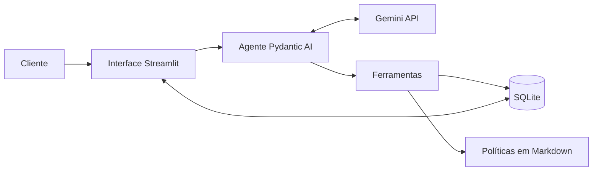
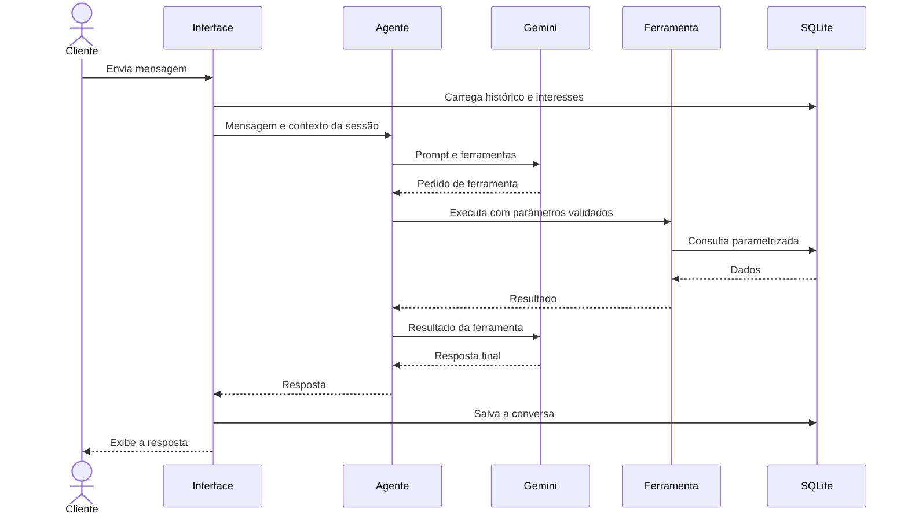

# Arquitetura

## 1. Visão geral

O sistema separa duas responsabilidades. O modelo de linguagem interpreta a mensagem, escolhe a ação e redige a resposta. O código Python consulta os dados, calcula valores e aplica as regras de privacidade.



## 2. Componentes

| Componente | Responsabilidade |
|---|---|
| Interface | Identificar o cliente, exibir a conversa e mostrar as ferramentas usadas |
| Agente | Reunir persona, regras, contexto, histórico e ferramentas |
| Ferramentas | Expor operações controladas sobre produtos, pedidos, políticas e encaminhamentos |
| Regras de negócio | Calcular disponibilidade, preço e descontos |
| Persistência | Guardar dados da loja, conversas, interesses e encaminhamentos |
| Carga de dados | Validar os arquivos de origem e recriar o banco local |

## 3. Fluxo de uma mensagem



## 4. Modelo de dados

Tabelas carregadas da origem: `categories`, `products`, `promotions`, `customers`, `orders` e `order_items`.

Tabelas operacionais:

| Tabela | Campos principais | Finalidade |
|---|---|---|
| `conversations` | `id`, `phone` (único), `created_at`, `updated_at` | Uma conversa contínua por telefone |
| `messages` | `id`, `conversation_id`, `content`, `created_at` | Guardar o histórico: cada linha é uma mensagem do Pydantic AI serializada em JSON |
| `conversation_state` | `phone` (chave), `pedido_em_analise`, `produto_em_foco`, `updated_at` | Estado pequeno da conversa, mantido em código (ADR-014) |
| `product_interests` | `id`, `phone`, `product_id`, `status`, `created_at` | Acompanhar interesses em produtos |
| `handoffs` | `id`, `phone`, `reason`, `summary`, `created_at` | Registrar encaminhamentos para a equipe |

## 5. Decisões de arquitetura

### ADR-001: Function calling como padrão do agente

- **Status:** Aceita.
- **Contexto:** o agente precisa decidir quando consultar dados, políticas ou responder diretamente.
- **Decisão:** expor operações de negócio como ferramentas especializadas.
- **Alternativas:** agente de SQL, que amplia o risco de consultas indevidas; RAG para tudo, fraco em filtros exatos; regras fixas, limitadas diante da linguagem natural.
- **Consequências:** ganhamos controle e testabilidade. Novas capacidades exigem novas ferramentas.

### ADR-002: Pydantic AI como framework

- **Status:** Aceita.
- **Contexto:** o sistema tem um agente, algumas ferramentas e necessidade de testes sem chamadas reais.
- **Decisão:** usar Pydantic AI, com versão fixada.
- **Alternativas:** `google-genai`, que exigiria mais código de integração; LangGraph, mais adequado a fluxos com vários estados.
- **Consequências:** há menos código de integração e tipos explícitos. O projeto passa a depender da evolução do framework.

### ADR-003: Gemini 3.5 Flash-Lite como modelo

- **Status:** Aceita.
- **Contexto:** o MVP precisa de function calling, baixa latência e operação sem custo.
- **Decisão:** usar `gemini-3.5-flash-lite` no plano gratuito, com nome definido em configuração.
- **Validação:** em 31/10/2026, o modelo respondeu um pedido mínimo em 1,0 s e concluiu a consulta de preço com ferramenta em 3,2 s. No mesmo teste, `gemini-flash-latest` e `gemini-3.8-flash` não responderam em 40 s, `gemini-3.5-flash` levou 8,1 s e `gemini-2.5-flash` não estava disponível para a conta.
- **Alternativas:** modelos pagos, sem necessidade neste estágio; modelos locais, com maior esforço de instalação.
- **Consequências:** não há custo inicial. A cota limita testes e uso simultâneo, e os termos de uso de dados do plano devem ser revisados antes de qualquer dado real.

### ADR-011: Versões de modelo fixas

- **Status:** Aceita.
- **Contexto:** apelidos como `gemini-flash-latest` podem apontar para outro modelo sem aviso. Isso pode alterar o comportamento, a latência e o custo do atendimento sem nenhuma mudança no código. Em uma plataforma multi-tenant, o impacto alcançaria várias empresas ao mesmo tempo.
- **Decisão:** não usar apelidos como `latest`. O sistema deve configurar sempre um identificador de modelo explícito, em todos os ambientes.
- **Alternativas:** apelidos `latest`, que recebem melhorias automaticamente, mas tiram da equipe o controle sobre quando o comportamento muda.
- **Consequências:** toda troca de modelo passa a ser uma mudança deliberada, validada antes da implantação pelos testes e pela avaliação das respostas. A equipe precisa acompanhar a descontinuação de modelos e planejar as migrações. Um identificador explícito ainda pode ser atualizado pelo provedor, então a versão efetiva retornada na resposta deve ser monitorada em produção.

### ADR-012: Dados apresentados ao cliente traduzidos em código

- **Status:** Aceita.
- **Contexto:** o banco guarda códigos em inglês, como o status `shipped` do pedido. Na validação com o Gemini, o agente repassou o código ao cliente. Pedir ao modelo que traduza cada valor deixaria o resultado sujeito a variações e a erros sem relação com os dados.
- **Decisão:** uma camada em código traduz os dados do pedido antes de entregá-los ao agente. O código mantém o valor original (`status`), mas o modelo recebe apenas o texto em português (`situacao`): o campo original é excluído do retorno da ferramenta. O prompt manda o agente repetir a situação como veio. A tradução é um mapa fixo de 1 para 1, sem acrescentar significado que os dados não tenham: `pending` é "pendente", `confirmed` é "confirmado", `shipped` é "enviado", `delivered` é "entregue" e `cancelled` é "cancelado". A forma de pagamento já segue esse princípio.
- **Alternativas:** deixar o modelo traduzir, mais simples e menos confiável; substituir `status` pelo texto, o que perderia o registro original exigido pelo DQ-16 e pelo TC-301.
- **Consequências:** a tradução é testável sem chamar o modelo, e um novo status exige atualizar o mapa, o que a validação da carga (`docs/03-dados.md`, seção 8) já impede de passar despercebido. O modelo continua redigindo a frase, então o texto final ainda depende do prompt e da avaliação manual. O mesmo princípio vale para novos dados exibidos ao cliente: formatar em código, não pedir ao modelo.

### ADR-013: Arquitetura híbrida com guarda na saída

- **Status:** Aceita para o MVP.
- **Contexto:** o modelo escolhe a ferramenta e redige a resposta, então pode citar valores que a ferramenta não devolveu. As próximas issues (trocas, histórico, interesses, escopo) acrescentam regras e ferramentas, o que amplia essa superfície. Trocar a orquestração por uma em que o modelo só interpreta a intenção é possível, mas não cabe no prazo do MVP.
- **Decisão:** manter o function calling do ADR-001 e mover para o código tudo o que não depende de interpretação:
  1. **Fatos prontos.** Valores, datas, situações e vereditos de regra (como o prazo de devolução) são calculados e formatados em código. O modelo apenas os repassa (ADR-012).
  2. **Guarda na saída.** Antes de a resposta chegar ao cliente, o código confere se todo valor em reais, percentual, data e código de rastreio citado consta nos retornos das ferramentas daquele turno ou na própria mensagem do cliente. Datas são comparadas pelo dia, não pelo formato. Se algum valor não for confirmado, o modelo recebe um pedido de correção uma única vez. Persistindo o problema, o cliente recebe uma resposta segura, sem o texto do modelo.
  3. **Estado da conversa em código.** Os dados que precisam atravessar mensagens, como o pedido em análise e o produto em foco, ficam em uma estrutura pequena persistida por telefone, e não na memória do modelo (ADR-014).
  4. **Memória curta.** O modelo recebe apenas as últimas mensagens da conversa, cortadas em turnos inteiros, nunca uma chamada de ferramenta separada de seu retorno (ADR-014).
  5. **Dados mínimos.** Do cadastro, o modelo recebe só o primeiro nome.
- **Alternativas:** modelo que apenas interpreta, em duas etapas (primeira chamada devolve intenção e dados, o código executa as ferramentas e monta os fatos, a segunda redige). É mais previsível e usa sempre 2 requisições, mas exige reescrever a orquestração e foi adiada.
- **Consequências:** a guarda pega o erro mais perigoso, o valor inventado, sem custo quando a resposta está correta; cada correção custa uma requisição. Ela não detecta erro de interpretação, como confundir troca com arrependimento, nem números escritos por extenso. A evolução para duas etapas continua possível, porque as ferramentas e seus testes são reaproveitados.

### ADR-014: Histórico e estado da conversa persistidos por telefone

- **Status:** Aceita.
- **Contexto:** o cliente volta em outra sessão e espera continuar a conversa. Reenviar todo o histórico consome cota (ADR-008), e confiar na memória do modelo para saber qual pedido ou produto está em discussão deixa a conversa sujeita a esquecimentos. A API do modelo também rejeita uma conversa em que uma chamada de ferramenta aparece sem o seu retorno.
- **Decisão:**
  1. **Uma conversa por telefone.** O telefone normalizado por `src/phone.py` é a chave. Telefone inválido ou ausente não identifica ninguém: a conversa não é carregada nem salva e vale só para a tela aberta.
  2. **Mensagens.** Cada mensagem do Pydantic AI (`ModelRequest` ou `ModelResponse`) é serializada em JSON com `ModelMessagesTypeAdapter` e guardada em `messages`. O banco guarda o registro completo; o corte é feito na leitura. Uma linha ilegível descarta o que veio antes dela, em vez de travar o atendimento.
  3. **Regra de corte.** O modelo recebe no máximo 7 mensagens. O corte começa no primeiro *turno* inteiro que cabe: um turno começa em uma fala do cliente que não responde a uma chamada de ferramenta, e vai até a próxima fala. Um turno que estoura o limite é descartado por completo. Com ferramenta, um turno tem 4 mensagens (fala, chamada, retorno, resposta), então 7 mensagens comportam um turno com ferramenta; sem ferramenta, o turno tem 2 e cabem 3. O corte é feito pelo próprio código ao carregar o histórico, e não por um *history processor* do Pydantic AI, porque o processador roda a cada chamada ao modelo dentro do turno e substitui o histórico da execução, o que poderia mexer nas fontes da guarda (ADR-013).
  4. **Guarda na saída.** Continua considerando só o turno atual (`fontes_do_turno`). Valores de mensagens antigas não sustentam respostas novas, mesmo estando no histórico enviado ao modelo.
  5. **Resposta segura.** Quando a guarda desiste, o histórico guarda só a fala do cliente e a resposta segura, sem a tentativa rejeitada.
  6. **Estado.** A tabela `conversation_state` guarda, por telefone, `pedido_em_analise` (número do pedido) e `produto_em_foco` (id do produto). O código os preenche a partir dos retornos das ferramentas: um único pedido encontrado define o pedido em análise, e uma busca com um único produto define o produto em foco. Buscas com vários resultados não alteram o estado. Os dois campos entram no contexto dinâmico do prompt (ADR-007). Não há máquina de estados: cada campo é só um valor.
  7. **Sem chave estrangeira para a origem.** As tabelas operacionais não referenciam `products` nem `orders`, porque a carga recria essas tabelas. Os ids são validados pelo código que os grava (`CHECK` maior que zero).
- **Alternativas:** guardar o histórico inteiro em um único campo, o que impede o corte por mensagem; resumir conversas antigas com o modelo, o que gasta cota e pode inventar; deixar o modelo registrar o foco por conta própria, o que reabre o problema da memória.
- **Consequências:** a continuidade não depende do modelo, e o isolamento por telefone vale para histórico e estado. O estado só muda quando uma ferramenta devolve exatamente um resultado, então o foco pode ficar desatualizado até a próxima busca. A pergunta pendente não foi criada: entra com a issue #6, quando houver quem a preencha. O telefone digitado não prova identidade (ADR-009), então quem digitar o telefone de outra pessoa vê a conversa dela; em produção, o canal autenticado resolve isso.

### ADR-004: SQLite como armazenamento

- **Status:** Aceita.
- **Contexto:** os dados chegam em CSV, e o sistema também precisa persistir conversas.
- **Decisão:** carregar os CSVs em SQLite e usar o mesmo banco para os dados operacionais.
- **Alternativas:** leitura direta com pandas, sem persistência para conversas; PostgreSQL, com operação desnecessária no MVP.
- **Consequências:** o ambiente é simples e reprodutível. Uso concorrente em produção exigiria migração.

### ADR-005: Consultas fixas e parametrizadas

- **Status:** Aceita.
- **Contexto:** filtros de disponibilidade e privacidade não podem depender do modelo.
- **Decisão:** o modelo escolhe parâmetros, mas não escreve SQL.
- **Consequências:** o comportamento é auditável. Perguntas analíticas livres ficam fora do MVP.

### ADR-006: Consulta de políticas por seção

- **Status:** Aceita.
- **Contexto:** o manual tem 8 páginas, e a extração automática desalinha tabelas, como a de horários.
- **Decisão:** manter uma versão revisada em Markdown, consultada por seção.
- **Alternativas:** banco vetorial, que adiciona componentes sem ganho relevante para este volume.
- **Consequências:** a recuperação é previsível e barata. O arquivo precisa ser mantido junto com o manual, e um manual muito maior exigiria reavaliar a busca semântica.

### ADR-007: Prompt em duas partes

- **Status:** Aceita.
- **Contexto:** o agente precisa de comportamento estável e de informações específicas de cada conversa.
- **Decisão:** separar instruções fixas, com persona e regras, de um contexto dinâmico com data, cliente e interesses pendentes. Usar temperatura baixa e descrições claras nas ferramentas.
- **Consequências:** o prompt fica mais curto e fácil de manter. Regras críticas continuam garantidas em código.

### ADR-008: Memória estruturada de interesses

- **Status:** Aceita.
- **Contexto:** reenviar todo o histórico consome cota e não garante a recuperação de uma informação antiga.
- **Decisão:** limitar o histórico enviado ao modelo e guardar interesses em `product_interests`.
- **Consequências:** o dado de negócio persiste entre conversas. O agente precisa registrar o interesse corretamente.

### ADR-009: Identificação pela sessão

- **Status:** Aceita para o MVP.
- **Contexto:** consultas de pedidos precisam respeitar o titular dos dados.
- **Decisão:** resolver o cliente a partir do telefone da sessão e nunca aceitar `customer_id` como argumento do modelo.
- **Consequências:** uma mensagem não troca o titular da consulta. Como o telefone digitado não prova identidade, produção exige identificação pelo canal autenticado.

### ADR-010: Streamlit como interface

- **Status:** Aceita.
- **Contexto:** o MVP precisa de um chat web simples, mantido em Python.
- **Decisão:** usar Streamlit.
- **Alternativas:** FastAPI com front-end próprio, que exigiria mais desenvolvimento.
- **Consequências:** a entrega é rápida. Um canal de produção exigirá outra camada de entrada.

## 6. Segurança e privacidade

- Chaves ficam em variáveis de ambiente, fora do Git.
- Consultas usam parâmetros, nunca concatenação de texto.
- Pedidos são filtrados pelo cliente da sessão.
- Mensagens e documentos são tratados como dados, não como instruções do sistema.
- Dados pessoais são limitados ao necessário para cada resposta.

## 7. Estrutura de diretórios

```text
.
├── app.py                  # Interface Streamlit
├── src/
│   ├── agent.py            # Agente, prompt e ferramentas
│   ├── catalog.py          # Busca, disponibilidade e preços
│   ├── config.py           # Configurações
│   ├── database.py         # Conexão com o banco
│   ├── load_data.py        # Validação e carga dos dados
│   ├── memory.py           # Histórico e estado da conversa por telefone
│   └── policies.py         # Leitura das políticas
├── scripts/
│   └── simulate_restock.py # Simula uma reposição de estoque
├── data/
│   ├── *.csv               # Dados de origem
│   ├── políticas_da_loja.pdf
│   └── politicas.md        # Políticas revisadas
├── examples/               # Conversas de referência
├── tests/
└── docs/
```

## 8. Evolução para produção

| Tema | Evolução |
|---|---|
| Canal | Integrar com a API oficial do WhatsApp |
| Identidade | Usar o número autenticado pelo canal |
| Dados | Integrar com ERP e sistema de pedidos |
| Banco | Migrar para PostgreSQL |
| Observabilidade | Registrar métricas de uso, falhas e transferências para humanos |
| Qualidade | Adotar avaliações contínuas das respostas |

## 9. Referências

- [Pydantic AI: modelos Google](https://github.com/pydantic/pydantic-ai/blob/main/docs/models/google.md)
- [Pydantic AI: histórico de mensagens](https://github.com/pydantic/pydantic-ai/blob/main/docs/message-history.md)
- [SDK Python do Google Gen AI](https://googleapis.github.io/python-genai/)
- [LangGraph: checkpointers](https://docs.langchain.com/oss/python/langgraph/checkpointers)
- [Gemini API: limites de uso](https://ai.google.dev/gemini-api/docs/rate-limits)
- [Gemini API: preços](https://ai.google.dev/gemini-api/docs/pricing)
