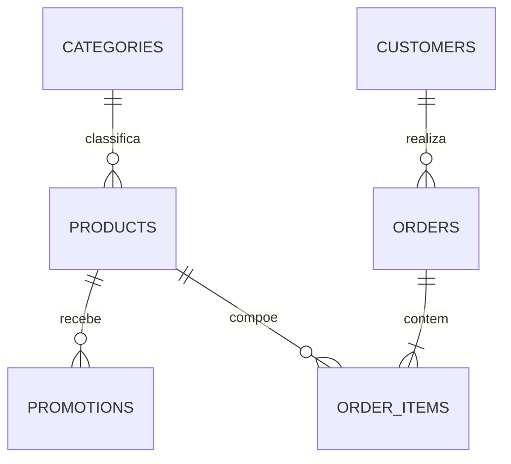

# Dados

## 1. Fontes

| Arquivo | Conteúdo | Registros | Uso no sistema |
|---|---|---|---|
| `products.csv` | Catálogo, preços, estoque, status e especificações | 65 | Busca de produtos |
| `categories.csv` | Categorias de instrumentos | 9 | Filtro de busca |
| `promotions.csv` | Descontos por produto | 25, sendo 4 ativas | Cálculo de preços |
| `customers.csv` | Cadastro de clientes | 50 | Identificação e personalização |
| `orders.csv` | Pedidos, pagamento, status e rastreio | 20 | Consulta de pedidos |
| `order_items.csv` | Itens de cada pedido | 22 | Detalhes do pedido |
| `políticas_da_loja.pdf` | Manual de atendimento, versão 2.1 | 8 páginas | Origem de `politicas.md` |

Os arquivos de origem são somente leitura. O banco SQLite é um artefato gerado e pode ser recriado a qualquer momento.

## 2. Relacionamentos

A validação inicial não encontrou registros órfãos nem ids duplicados.

## 3. Regras de disponibilidade

O `status` tem prioridade sobre o estoque.

| Status | Estoque | Classificação | Comportamento |
|---|---|---|---|
| `active` | Maior que 0 | Disponível | Pode ser oferecido |
| `active` | 0 | Indisponível | Sugerir alternativas e registrar interesse |
| `coming_soon` | Qualquer | Lançamento | Não confirmar disponibilidade |
| `discontinued` | Qualquer | Fora de catálogo | Sugerir modelos equivalentes |

## 4. Qualidade dos dados

### 4.1 Catálogo

| ID | Achado | Tratamento |
|---|---|---|
| DQ-01 | Giannini GF-3D (id 96) está ativo e com estoque 0 | Classificar como indisponível |
| DQ-02 | Ibanez Bass 2X (id 136) está descontinuado com estoque 13 | Classificar como fora de catálogo |
| DQ-03 | Kala KA-ABP-CTG (id 130) é `coming_soon`, tem estoque 2 e aparece em pedidos | Classificar como lançamento |
| DQ-04 | Vários produtos entre os ids 135 e 144 têm nome e descrição de marcas ou modelos diferentes | Usar o nome como fonte oficial e não afirmar marca pela descrição |
| DQ-05 | Yamaha Bass 3X (id 137) cita 5 cordas na descrição e 4 nas especificações | Não afirmar o número de cordas sem validação |
| DQ-06 | As categorias 6, 7 e 8 não têm produtos, e o manual cita mais de 300 itens | Responder conforme o catálogo disponível |

### 4.2 Promoções

| ID | Achado | Tratamento |
|---|---|---|
| DQ-07 | 21 de 25 promoções estão inativas | Considerar apenas `is_active = 1` |
| DQ-08 | Promoções não têm data de início nem de fim | Usar `is_active` como indicador de vigência |
| DQ-09 | Há campanhas que não aparecem no manual | Usar `promotions.csv` como fonte dos descontos vigentes |

### 4.3 Clientes

| ID | Achado | Tratamento |
|---|---|---|
| DQ-10 | Os clientes 11 e 43 usam o mesmo e-mail e têm nomes parecidos | Identificar pelo telefone e não unificar cadastros automaticamente |

### 4.4 Pedidos

| ID | Achado | Tratamento |
|---|---|---|
| DQ-11 | Pedido 3: total de R$ 3.450,00; soma dos itens, R$ 3.498,00 | Exibir `total_brl` como total registrado |
| DQ-12 | Pedido 20: total de R$ 1.400,00; soma dos itens, R$ 1.488,00 | Exibir `total_brl` como total registrado |
| DQ-13 | Pedidos pagos com PIX não refletem os 5% de desconto no total | Não inferir o valor efetivamente pago |
| DQ-14 | Pedidos 9, 16 e 18 têm parcelas abaixo do mínimo vigente | Preservar o histórico; a regra vale para novas orientações |
| DQ-15 | Pedidos 3 e 14 incluem um produto `coming_soon` | Preservar o histórico |
| DQ-16 | Pedido 8 segue como `shipped` após a entrega estimada | Informar o status registrado e encaminhar se houver atraso relatado |
| DQ-17 | Pedidos não têm canal de compra nem data real de entrega | Perguntar o canal e usar `estimated_delivery` como aproximação |
| DQ-18 | Não há previsão de reposição de estoque | Informar apenas o estoque atual |

### 4.5 Manual de políticas

| ID | Achado | Tratamento |
|---|---|---|
| DQ-19 | Telefone (67) 3341-4444 e WhatsApp (67) 3321-4500 divergem | Usar 3341-4444 como telefone geral e 3321-4500 como WhatsApp |
| DQ-20 | E-mail aparece com e sem acento | Usar `contato@emporiodamusica.com.br` |
| DQ-21 | Tabela de pagamento e seção 3.1 divergem sobre a parcela mínima | Usar a seção 3.1, por ser mais específica |
| DQ-22 | Até 3x, o texto cita "sem valor mínimo (exceto abaixo de R$ 50,00)" | Interpretar como parcela mínima de R$ 50,00 |
| DQ-23 | Troca por defeito em 30 dias da compra e garantia legal de 90 dias do recebimento | Tratar como regras distintas |
| DQ-24 | Arrependimento é citado apenas para compras online | Confirmar o canal antes de concluir |
| DQ-25 | Lojas parceiras são citadas, mas não há lista | Redirecionar sem indicar lojas |
| DQ-26 | A troca por preferência tem prazo de 7 dias, mas o manual não diz a partir de quando | Contar a partir do recebimento, como o arrependimento |

Os itens DQ-19 a DQ-24 e DQ-26 devem ser validados com a gestão da loja antes de um uso em produção.

## 5. Regras de negócio

### 5.1 Preço

- Preço promocional deve aparecer com o preço original e o percentual de desconto.
- O PIX tem 5% de desconto sobre o preço de tabela.
- Promoções não são cumulativas, e o desconto do PIX não se aplica a preços promocionais.
- Valores são calculados em código e arredondados para duas casas decimais.

### 5.2 Parcelamento

| Parcelas | Parcela mínima |
|---|---|
| 1x a 3x | R$ 50,00 |
| 4x a 6x | R$ 80,00 |
| 7x a 12x | R$ 100,00 |

### 5.3 Data de referência

Os pedidos vão até 2026-03-22, então o sistema usa a data configurável `2026-03-25`. Isso mantém prazos coerentes com os dados e permite testes repetíveis.

Com esse valor, nenhum pedido entregue está dentro dos 7 dias de arrependimento. O mais recente tem entrega estimada em 2026-02-17, 36 dias antes. Os casos dentro do prazo são validados em testes, com a data informada pelo próprio teste.

O valor vem da variável de ambiente `DATA_DE_REFERENCIA` (formato `AAAA-MM-DD`), lida por `config.data_de_referencia()`. Um valor inválido interrompe a execução com uma mensagem que indica o formato.

### 5.4 Prazos de troca e devolução

Calculados em `src/returns.py`, a partir do manual (DQ-23, DQ-24 e DQ-26). O recebimento é a entrega estimada do pedido (DQ-17), sempre apresentada como aproximação.

| Motivo | Regra | Contagem |
|---|---|---|
| Arrependimento | 7 dias corridos, só em compra online | Recebimento |
| Defeito (troca) | 30 dias corridos | Compra |
| Defeito (garantia legal) | 90 dias corridos | Recebimento |
| Preferência | 7 dias corridos | Recebimento |

O último dia da contagem ainda está dentro do prazo. Pedidos `pending`, `confirmed` e `cancelled` não têm produto recebido. Em arrependimento, o canal de compra precisa ser perguntado ao cliente. Datas apresentadas ao cliente saem em `dd/mm/aaaa`.

## 6. Pipeline de carga

1. Ler os arquivos de origem sem alterá-los.
2. Converter números, datas e booleanos.
3. Interpretar `specs` como JSON.
4. Normalizar telefones para conter apenas dígitos, sem o código do país.
5. Validar cada registro conforme a seção 8, antes de alterar o banco.
6. Criar as tabelas e os índices no SQLite.
7. Criar as tabelas operacionais.
8. Registrar os erros de validação e interromper a carga em caso de falha crítica.

## 7. Privacidade

- Apenas o cliente da sessão pode consultar seus pedidos.
- E-mail e cidade não são necessários para as respostas do MVP e não são expostos ao agente.
- Do cadastro, o modelo recebe apenas o primeiro nome. Sobrenome e telefone ficam no código.
- Os dados versionados são fictícios. Telefones podem coincidir com números reais, então não devem ser usados para contato.
- O histórico (`messages`) guarda o que o cliente digitou e o que o agente respondeu, incluindo os retornos das ferramentas do turno, como itens e totais de pedidos. Ele pode conter dados pessoais, como nomes, endereços ou números de pedido informados livremente, e é tratado como dado pessoal: fica no banco local, fora do Git, e é associado só ao telefone da conversa.
- O estado da conversa guarda apenas ids (de pedido e de produto) por telefone.
- Os encaminhamentos guardam o telefone, o motivo e um resumo em texto livre, escrito pelo modelo ou, na resposta segura, a própria fala do cliente. O resumo pode conter dados pessoais e é tratado como o histórico: fica no banco local, fora do Git, e é associado só ao telefone.
- Os interesses guardam o telefone e o id do produto. Ao modelo chegam só os nomes dos produtos do telefone da sessão.
- Dados reais só podem ser usados após a revisão dos termos do provedor e a adequação à LGPD.

## 8. Validação de entrada

Nenhum dado entra no sistema sem validação. Há duas fronteiras: a carga dos arquivos de origem e os argumentos das ferramentas do agente.

### 8.1 Carga dos arquivos

Qualquer violação interrompe a carga com `ErroDeCarga`, que informa a entidade e o id. Toda a validação ocorre antes de recriar as tabelas, então uma carga que falha preserva o banco anterior.

| Entidade | Regras |
|---|---|
| Todas | Id numérico e sem duplicidade |
| Produto | Categoria existente; preço não negativo e sem fração de centavo; estoque inteiro não negativo; `status` em `active`, `coming_soon` ou `discontinued` |
| Promoção | Produto existente; desconto de 0 a 100; `is_active` igual a 0 ou 1 |
| Cliente | Nome preenchido; telefone brasileiro com 10 ou 11 dígitos, aceitando `+55`; telefone sem duplicidade entre clientes |
| Pedido | Cliente existente; total não negativo e sem fração de centavo; `status` em `pending`, `confirmed`, `shipped`, `delivered` ou `cancelled`; pagamento em `pix`, `debit`, `boleto` ou `credit_1x` a `credit_12x` |
| Item de pedido | Pedido e produto existentes; quantidade positiva |

Valores monetários com mais de duas casas são recusados, e não arredondados, para que um erro na origem não passe despercebido.

### 8.1.1 Tabelas operacionais

As tabelas de conversa não vêm de arquivos, mas seguem o mesmo rigor na gravação. Elas são criadas com `CREATE TABLE IF NOT EXISTS` e nunca são recriadas pela carga, para não apagar conversas.

| Tabela | Regras |
|---|---|
| `conversations` | Telefone normalizado com 10 ou 11 dígitos, único; telefone inválido não grava nada |
| `messages` | Conversa existente; conteúdo é uma mensagem do Pydantic AI serializada pelo próprio adaptador. Na leitura, uma linha que não valida é descartada com tudo o que veio antes dela |
| `conversation_state` | Telefone normalizado; ids opcionais, mas sempre maiores que zero (`CHECK`) |
| `handoffs` | Telefone normalizado com 10 ou 11 dígitos; `reason` restrito a `reclamacao`, `sem_resposta_segura` e `atendente_solicitado` (`CHECK`); resumo sem espaços nas pontas, não vazio (`CHECK`) e com no máximo 500 caracteres (cortado no código). Telefone inválido ou resumo vazio não gravam nada; o mesmo telefone, motivo e resumo não duplicam |
| `product_interests` | Telefone normalizado com 10 ou 11 dígitos; produto existente, validado pelo código que grava, e id maior que zero (`CHECK`); `status` restrito a `pending` (`CHECK`); sem duplicidade por telefone e produto (`UNIQUE`). Telefone inválido ou produto inexistente não gravam nada |

**Evolução do esquema.** `CREATE TABLE IF NOT EXISTS` não altera tabelas existentes. Se uma tabela operacional ganhar uma coluna que o código lê, a evolução precisa de um `ALTER TABLE` idempotente em `criar_tabelas`. As issues #6, #8 e #9 não alteraram tabelas existentes: `product_interests` e `handoffs` são novas e é criada por `criar_tabelas`, então não há migração pendente. Ampliar os valores de `status` exigirá recriar a tabela, porque o SQLite não altera um `CHECK`.

Reposição simulada: `scripts/simulate_restock.py` altera só `products.stock_quantity` no banco local, e `python -m src.load_data` o restaura a partir dos CSVs. As tabelas operacionais, como os interesses, sobrevivem à carga.

### 8.2 Argumentos das ferramentas

O modelo é uma fonte de entrada não confiável. Os argumentos são validados pelo Pydantic AI, e um valor inválido volta ao modelo como pedido de correção:

- `preco_maximo`, `valor`: maiores que zero.
- `parcelas`, `numero_pedido`, `product_id`: inteiros a partir de 1.
- `motivo` (arrependimento, defeito ou preferencia) e `canal` (online ou presencial) da devolução, e `motivo` do encaminhamento (reclamacao, atendente_solicitado ou sem_resposta_segura): enumerações validadas pelo Pydantic.
- `secao`: uma das seções de `policies.SECOES`.
- Parcelas acima de 12 não são recusadas: a resposta informa o limite de 12x.
- Argumentos desconhecidos, como `customer_id`, são rejeitados.

O telefone da sessão não é argumento do modelo. Ele é normalizado por `src/phone.py`, e um telefone inválido ou sem cadastro não identifica ninguém.
