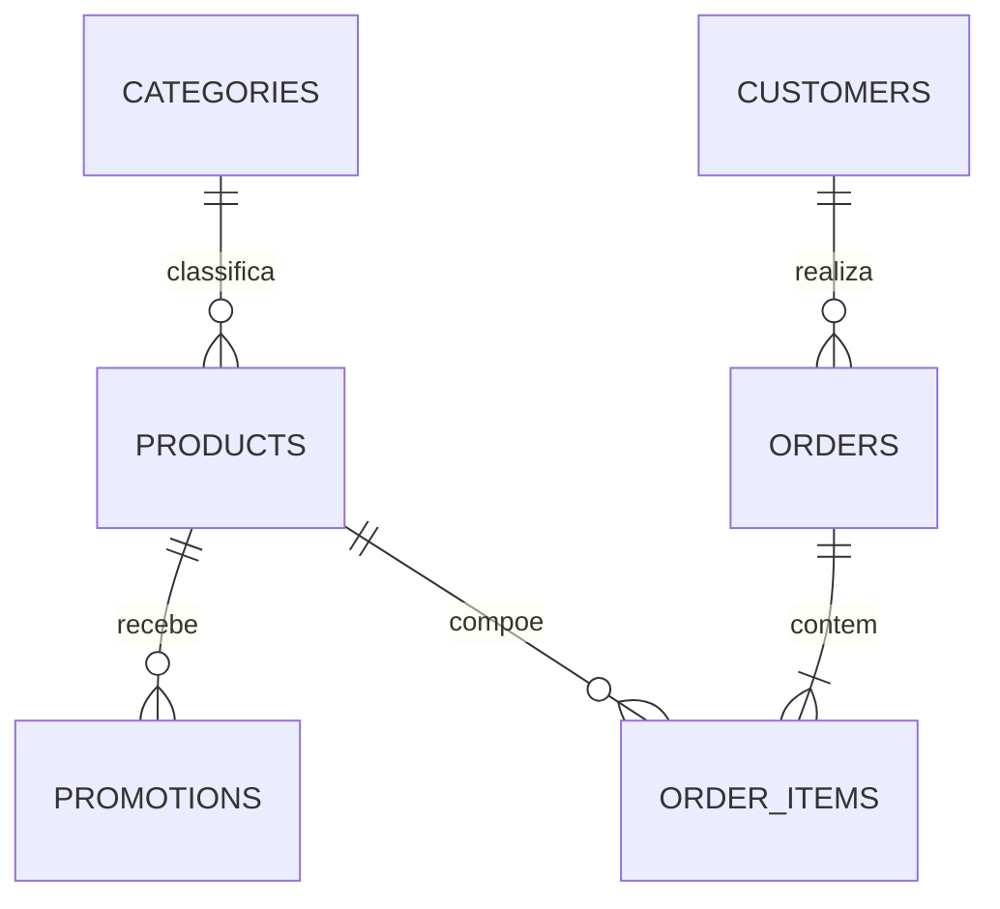

# Dados

## 1. Fontes

| Arquivo | Conteúdo | Registros | Uso no sistema |
|---|---|---|---|
| `products.csv` | Catálogo, preços, estoque, status e especificações | 65 | Busca de produtos |
| `categories.csv` | Categorias de instrumentos | 9 | Filtro de busca |
| `promotions.csv` | Descontos por produto | 25, sendo 4 ativas | Cálculo de preços |
| `customers.csv` | Cadastro de clientes | 50 | Identificação e personalização |
| `orders.csv` | Pedidos, pagamento, status e rastreio | 20 | Consulta de pedidos |
| `order_items.csv` | Itens de cada pedido | 22 | Detalhes do pedido |
| `políticas_da_loja.pdf` | Manual de atendimento, versão 2.1 | 8 páginas | Origem de `politicas.md` |

Os arquivos de origem são somente leitura. O banco SQLite é um artefato gerado e pode ser recriado a qualquer momento.

## 2. Relacionamentos

A validação inicial não encontrou registros órfãos nem ids duplicados.

## 3. Regras de disponibilidade

O `status` tem prioridade sobre o estoque.

| Status | Estoque | Classificação | Comportamento |
|---|---|---|---|
| `active` | Maior que 0 | Disponível | Pode ser oferecido |
| `active` | 0 | Indisponível | Sugerir alternativas e registrar interesse |
| `coming_soon` | Qualquer | Lançamento | Não confirmar disponibilidade |
| `discontinued` | Qualquer | Fora de catálogo | Sugerir modelos equivalentes |

## 4. Qualidade dos dados

### 4.1 Catálogo

| ID | Achado | Tratamento |
|---|---|---|
| DQ-01 | Giannini GF-3D (id 96) está ativo e com estoque 0 | Classificar como indisponível |
| DQ-02 | Ibanez Bass 2X (id 136) está descontinuado com estoque 13 | Classificar como fora de catálogo |
| DQ-03 | Kala KA-ABP-CTG (id 130) é `coming_soon`, tem estoque 2 e aparece em pedidos | Classificar como lançamento |
| DQ-04 | Vários produtos entre os ids 135 e 144 têm nome e descrição de marcas ou modelos diferentes | Usar o nome como fonte oficial e não afirmar marca pela descrição |
| DQ-05 | Yamaha Bass 3X (id 137) cita 5 cordas na descrição e 4 nas especificações | Não afirmar o número de cordas sem validação |
| DQ-06 | As categorias 6, 7 e 8 não têm produtos, e o manual cita mais de 300 itens | Responder conforme o catálogo disponível |

### 4.2 Promoções

| ID | Achado | Tratamento |
|---|---|---|
| DQ-07 | 21 de 25 promoções estão inativas | Considerar apenas `is_active = 1` |
| DQ-08 | Promoções não têm data de início nem de fim | Usar `is_active` como indicador de vigência |
| DQ-09 | Há campanhas que não aparecem no manual | Usar `promotions.csv` como fonte dos descontos vigentes |

### 4.3 Clientes

| ID | Achado | Tratamento |
|---|---|---|
| DQ-10 | Os clientes 11 e 43 usam o mesmo e-mail e têm nomes parecidos | Identificar pelo telefone e não unificar cadastros automaticamente |

### 4.4 Pedidos

| ID | Achado | Tratamento |
|---|---|---|
| DQ-11 | Pedido 3: total de R$ 3.450,00; soma dos itens, R$ 3.498,00 | Exibir `total_brl` como total registrado |
| DQ-12 | Pedido 20: total de R$ 1.400,00; soma dos itens, R$ 1.488,00 | Exibir `total_brl` como total registrado |
| DQ-13 | Pedidos pagos com PIX não refletem os 5% de desconto no total | Não inferir o valor efetivamente pago |
| DQ-14 | Pedidos 9, 16 e 18 têm parcelas abaixo do mínimo vigente | Preservar o histórico; a regra vale para novas orientações |
| DQ-15 | Pedidos 3 e 14 incluem um produto `coming_soon` | Preservar o histórico |
| DQ-16 | Pedido 8 segue como `shipped` após a entrega estimada | Informar o status registrado e encaminhar se houver atraso relatado |
| DQ-17 | Pedidos não têm canal de compra nem data real de entrega | Perguntar o canal e usar `estimated_delivery` como aproximação |
| DQ-18 | Não há previsão de reposição de estoque | Informar apenas o estoque atual |

### 4.5 Manual de políticas

| ID | Achado | Tratamento |
|---|---|---|
| DQ-19 | Telefone (67) 3341-4444 e WhatsApp (67) 3321-4500 divergem | Usar 3341-4444 como telefone geral e 3321-4500 como WhatsApp |
| DQ-20 | E-mail aparece com e sem acento | Usar `contato@emporiodamusica.com.br` |
| DQ-21 | Tabela de pagamento e seção 3.1 divergem sobre a parcela mínima | Usar a seção 3.1, por ser mais específica |
| DQ-22 | Até 3x, o texto cita "sem valor mínimo (exceto abaixo de R$ 50,00)" | Interpretar como parcela mínima de R$ 50,00 |
| DQ-23 | Troca por defeito em 30 dias da compra e garantia legal de 90 dias do recebimento | Tratar como regras distintas |
| DQ-24 | Arrependimento é citado apenas para compras online | Confirmar o canal antes de concluir |
| DQ-25 | Lojas parceiras são citadas, mas não há lista | Redirecionar sem indicar lojas |

Os itens DQ-19 a DQ-24 devem ser validados com a gestão da loja antes de um uso em produção.

## 5. Regras de negócio

### 5.1 Preço

- Preço promocional deve aparecer com o preço original e o percentual de desconto.
- O PIX tem 5% de desconto sobre o preço de tabela.
- Promoções não são cumulativas, e o desconto do PIX não se aplica a preços promocionais.
- Valores são calculados em código e arredondados para duas casas decimais.

### 5.2 Parcelamento

| Parcelas | Parcela mínima |
|---|---|
| 1x a 3x | R$ 50,00 |
| 4x a 6x | R$ 80,00 |
| 7x a 12x | R$ 100,00 |

### 5.3 Data de referência

Os pedidos vão até 2026-03-22, então o sistema usa a data configurável `2026-03-25`. Isso mantém prazos coerentes com os dados e permite testes repetíveis.

Com esse valor, nenhum pedido entregue está dentro dos 7 dias de arrependimento. O mais recente tem entrega estimada em 2026-02-17, 36 dias antes. Os casos dentro do prazo são validados em testes, com a data informada pelo próprio teste.

## 6. Pipeline de carga

1. Ler os arquivos de origem sem alterá-los.
2. Converter números, datas e booleanos.
3. Interpretar `specs` como JSON.
4. Normalizar telefones para conter apenas dígitos.
5. Validar ids e relacionamentos.
6. Criar as tabelas e os índices no SQLite.
7. Criar as tabelas operacionais.
8. Registrar os erros de validação e interromper a carga em caso de falha crítica.

## 7. Privacidade

- Apenas o cliente da sessão pode consultar seus pedidos.
- E-mail e cidade não são necessários para as respostas do MVP e não são expostos ao agente.
- Os dados versionados são fictícios. Telefones podem coincidir com números reais, então não devem ser usados para contato.
- Dados reais só podem ser usados após a revisão dos termos do provedor e a adequação à LGPD.
