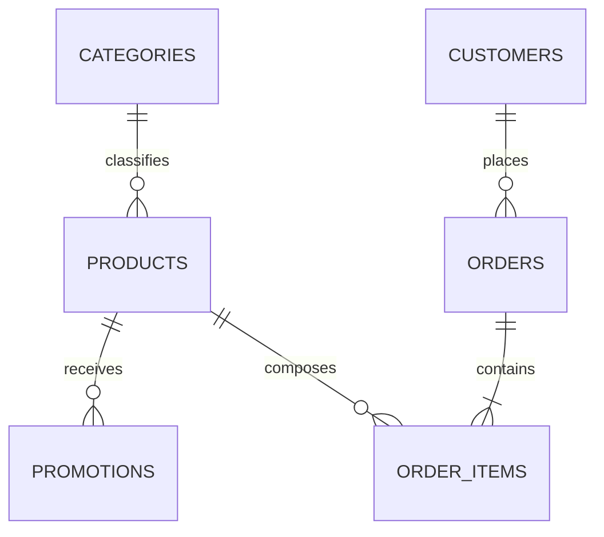

# Data

## 1. Sources

| File | Content | Records | Use in the system |
|---|---|---|---|
| `products.csv` | Catalog, prices, stock, status, and specifications | 65 | Product search |
| `categories.csv` | Instrument categories | 9 | Search filter |
| `promotions.csv` | Discounts per product | 25, of which 4 are active | Price calculation |
| `customers.csv` | Customer records | 50 | Identification and personalization |
| `orders.csv` | Orders, payment, status, and tracking | 20 | Order lookup |
| `order_items.csv` | Items of each order | 22 | Order details |
| `políticas_da_loja.pdf` | Customer service handbook, version 2.1 | 8 pages | Source of `politicas.md` |

The source files are read-only. The SQLite database is a generated artifact and can be recreated at any time.

## 2. Relationships

The initial validation found no orphan records and no duplicate ids.

## 3. Availability rules

`status` takes precedence over stock.

| Status | Stock | Classification | Behavior |
|---|---|---|---|
| `active` | Greater than 0 | Available | Can be offered |
| `active` | 0 | Unavailable | Suggest alternatives and register interest |
| `coming_soon` | Any | New release | Do not confirm availability |
| `discontinued` | Any | Discontinued | Suggest equivalent models |

## 4. Data quality

### 4.1 Catalog

| ID | Finding | Handling |
|---|---|---|
| DQ-01 | Giannini GF-3D (id 96) is active with stock 0 | Classify as unavailable |
| DQ-02 | Ibanez Bass 2X (id 136) is discontinued with stock 13 | Classify as discontinued |
| DQ-03 | Kala KA-ABP-CTG (id 130) is `coming_soon`, has stock 2, and appears in orders | Classify as a new release |
| DQ-04 | Several products between ids 135 and 144 have names and descriptions of different brands or models | Use the name as the official source and do not state the brand from the description |
| DQ-05 | Yamaha Bass 3X (id 137) mentions 5 strings in the description and 4 in the specifications | Do not state the number of strings without validation; the tool omits `strings` for this product (ADR-021) |
| DQ-06 | Categories 6, 7, and 8 have no products, and the handbook mentions more than 300 items | Answer according to the available catalog |

### 4.2 Promotions

| ID | Finding | Handling |
|---|---|---|
| DQ-07 | 21 of 25 promotions are inactive | Consider only `is_active = 1` |
| DQ-08 | Promotions have no start or end date | Use `is_active` as the validity indicator |
| DQ-09 | Some campaigns do not appear in the handbook | Use `promotions.csv` as the source of current discounts |

### 4.3 Customers

| ID | Finding | Handling |
|---|---|---|
| DQ-10 | Customers 11 and 43 share the same e-mail and have similar names | Identify by phone number and do not merge records automatically |

### 4.4 Orders

| ID | Finding | Handling |
|---|---|---|
| DQ-11 | Order 3: total of R$ 3.450,00; sum of items, R$ 3.498,00 | Show `total_brl` as the recorded total |
| DQ-12 | Order 20: total of R$ 1.400,00; sum of items, R$ 1.488,00 | Show `total_brl` as the recorded total |
| DQ-13 | Orders paid with PIX do not reflect the 5% discount in the total | Do not infer the amount actually paid |
| DQ-14 | Orders 9, 16, and 18 have installments below the current minimum | Preserve the history; the rule applies to new guidance |
| DQ-15 | Orders 3 and 14 include a `coming_soon` product | Preserve the history |
| DQ-16 | Order 8 remains `shipped` after the estimated delivery | Report the recorded status and hand off if a delay is reported |
| DQ-17 | Orders have no purchase channel and no actual delivery date | Ask for the channel and use `estimated_delivery` as an approximation |
| DQ-18 | There is no restock forecast | Report only the current stock |

### 4.5 Policy handbook

| ID | Finding | Handling |
|---|---|---|
| DQ-19 | Phone (67) 3341-4444 and WhatsApp (67) 3321-4500 differ | Use 3341-4444 as the general phone and 3321-4500 as WhatsApp |
| DQ-20 | The e-mail appears with and without an accent | Use `contato@emporiodamusica.com.br` |
| DQ-21 | The payment table and section 3.1 differ on the minimum installment | Use section 3.1, as it is more specific |
| DQ-22 | Up to 3x, the text says "sem valor mínimo (exceto abaixo de R$ 50,00)" ("no minimum amount, except below R$ 50,00") | Interpret as a minimum installment of R$ 50,00 |
| DQ-23 | Exchange for defect within 30 days of purchase and legal warranty of 90 days from receipt | Treat as separate rules |
| DQ-24 | The right of withdrawal is mentioned only for online purchases | Confirm the channel before concluding |
| DQ-25 | Partner stores are mentioned, but there is no list | Redirect without naming stores |
| DQ-26 | Exchange by preference has a 7-day deadline, but the handbook does not say from when | Count from receipt, like the right of withdrawal |

Items DQ-19 to DQ-24 and DQ-26 must be validated with store management before any production use.

## 5. Business rules

### 5.1 Price

- A promotional price must be shown with the original price and the discount percentage.
- PIX has a 5% discount on the list price.
- Promotions do not stack, and the PIX discount does not apply to promotional prices.
- Amounts are calculated in code and rounded to two decimal places.

### 5.2 Installments

| Installments | Minimum installment |
|---|---|
| 1x to 3x | R$ 50,00 |
| 4x to 6x | R$ 80,00 |
| 7x to 12x | R$ 100,00 |

### 5.3 Reference date

Orders go up to 2026-03-22, so the system uses the configurable date `2026-03-25`. This keeps deadlines consistent with the data and makes tests repeatable.

With this value, no delivered order is within the 7-day withdrawal period. The most recent one has an estimated delivery on 2026-02-17, 36 days earlier. Cases within the deadline are validated in tests, with the date set by the test itself.

The value comes from the `DATA_DE_REFERENCIA` environment variable (format `YYYY-MM-DD`), read by `config.data_de_referencia()`. An invalid value stops execution with a message stating the format.

### 5.4 Exchange and return deadlines

Calculated in `src/returns.py`, from the handbook (DQ-23, DQ-24, and DQ-26). Receipt is the order's estimated delivery (DQ-17), always presented as an approximation.

| Reason | Rule | Counted from |
|---|---|---|
| Withdrawal (regret) | 7 calendar days, online purchases only | Receipt |
| Defect (exchange) | 30 calendar days | Purchase |
| Defect (legal warranty) | 90 calendar days | Receipt |
| Preference | 7 calendar days | Receipt |

The last day of the count is still within the deadline. `pending`, `confirmed`, and `cancelled` orders have no received product. For withdrawal, the customer must be asked for the purchase channel. Dates shown to the customer use `dd/mm/yyyy`.

## 6. Load pipeline

1. Read the source files without changing them.
2. Convert numbers, dates, and booleans.
3. Parse `specs` as JSON.
4. Normalize phone numbers to digits only, without the country code.
5. Validate each record according to section 8, before changing the database.
6. Create the tables and indexes in SQLite.
7. Create the operational tables.
8. Report validation errors and stop the load on a critical failure.

## 7. Privacy

- Only the session's customer can look up their orders.
- E-mail and city are not needed for the MVP's answers and are not exposed to the agent.
- From the customer record, the model receives only the first name. Last name and phone number stay in the code.
- The committed data is fictitious. Phone numbers may match real numbers, so they must not be used for contact.
- The history (`messages`) stores what the customer typed and what the agent answered, including the tool results of the turn, such as order items and totals. It may contain personal data, such as names, addresses, or order numbers given freely, and is treated as personal data: it stays in the local database, outside Git, and is linked only to the conversation's phone number.
- The conversation state stores only ids (of order and product) per phone number.
- Handoffs store the phone number, the reason, and a free-text summary, written by the model or, for the safe answer, the customer's own message. The summary may contain personal data and is treated like the history: it stays in the local database, outside Git, and is linked only to the phone number.
- Interests store the phone number and the product id. The model receives only the product names for the session's phone number.
- Real data can only be used after reviewing the provider's terms and complying with the LGPD (Brazil's General Data Protection Law).
- Review of the Gemini API terms (version in force since March 23, 2026, updated on April 28, 2026): in the free service, Google may use prompts and responses to improve its products, and human reviewers may read them after they are disconnected from the account and the key. The terms advise against sending personal, sensitive, or confidential information to this service. In the paid service, content is not used to improve products. For this reason, the free tier serves only this project's fictitious data; any real data requires the paid tier and LGPD compliance.

## 8. Input validation

No data enters the system without validation. There are two boundaries: loading the source files and the arguments of the agent's tools.

### 8.1 Loading the files

Any violation stops the load with `ErroDeCarga`, which reports the entity and the id. All validation happens before the tables are recreated, so a failed load preserves the previous database.

| Entity | Rules |
|---|---|
| All | Numeric id, no duplicates |
| Product | Existing category; non-negative price with no fraction of a cent; non-negative integer stock; `status` in `active`, `coming_soon`, or `discontinued` |
| Promotion | Existing product; discount from 0 to 100; `is_active` equal to 0 or 1 |
| Customer | Name filled in; Brazilian phone number with 10 or 11 digits, accepting `+55`; no duplicate phone numbers across customers |
| Order | Existing customer; non-negative total with no fraction of a cent; `status` in `pending`, `confirmed`, `shipped`, `delivered`, or `cancelled`; payment in `pix`, `debit`, `boleto`, or `credit_1x` to `credit_12x` |
| Order item | Existing order and product; positive quantity |

Monetary values with more than two decimal places are rejected, not rounded, so that an error in the source does not go unnoticed.

### 8.1.1 Operational tables

The conversation tables do not come from files, but writes to them follow the same rigor. They are created with `CREATE TABLE IF NOT EXISTS` and never recreated by the load, so conversations are not erased.

| Table | Rules |
|---|---|
| `conversations` | Normalized phone number with 10 or 11 digits, unique; an invalid phone number writes nothing |
| `messages` | Existing conversation; the content is a Pydantic AI message serialized by the library's own adapter. On read, a row that does not validate is discarded along with everything before it |
| `conversation_state` | Normalized phone number; optional ids, always greater than zero (`CHECK`) |
| `handoffs` | Normalized phone number with 10 or 11 digits; `reason` restricted to `reclamacao`, `sem_resposta_segura`, and `atendente_solicitado` (`CHECK`); summary without leading or trailing spaces, not empty (`CHECK`), and at most 500 characters (truncated in code). An invalid phone number or an empty summary writes nothing; the same phone number, reason, and summary are not duplicated |
| `product_interests` | Normalized phone number with 10 or 11 digits; existing product, validated by the code that writes it, and id greater than zero (`CHECK`); `status` restricted to `pending` (`CHECK`); no duplicates per phone number and product (`UNIQUE`). An invalid phone number or a nonexistent product writes nothing |

**Schema evolution.** `CREATE TABLE IF NOT EXISTS` does not alter existing tables. If an operational table gains a column the code reads, the change needs an idempotent `ALTER TABLE` in `criar_tabelas`. Issues #6, #8, and #9 did not alter existing tables: `product_interests` and `handoffs` are new and created by `criar_tabelas`, so there is no pending migration. Extending the `status` values will require recreating the table, because SQLite does not alter a `CHECK`.

Simulated restock: `scripts/simulate_restock.py` changes only `products.stock_quantity` in the local database, and `python -m src.load_data` restores it from the CSVs. The operational tables, such as interests, survive the load.

### 8.2 Tool arguments

The model is an untrusted input source. Arguments are validated by Pydantic AI, and an invalid value goes back to the model as a correction request:

- `preco_maximo`, `valor`: greater than zero.
- `parcelas`, `numero_pedido`, `product_id`: integers starting at 1.
- The return's `motivo` (arrependimento, defeito, or preferencia) and `canal` (online or presencial), and the handoff's `motivo` (reclamacao, atendente_solicitado, or sem_resposta_segura): enumerations validated by Pydantic.
- `secao`: one of the sections in `policies.SECOES`.
- Installments above 12 are not rejected: the answer states the 12x limit.
- Unknown arguments, such as `customer_id`, are rejected.

The session's phone number is not a model argument. It is normalized by `src/phone.py`, and an invalid or unregistered phone number identifies no one.
